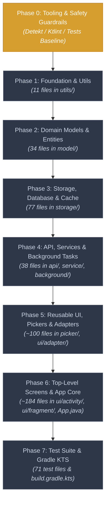

# 🚀 Cash Ledger: Pure Kotlin Migration Hub

<div align="center">


-critical?style=for-the-badge)

-3DDC84?style=for-the-badge&logo=android&logoColor=white)

</div>

---

## 📊 Live Progress Dashboard

> **How to update this dashboard:** When a PR lands that converts files, update the counts in the table below and bump the progress badges above.

```
Total Files Migrated: [▓░░░░░░░░░░░░░░░░░░░░░░░░░░░░░░░░░░░░░░░░░░░░░░░░░] 0.2% (1 / 517)
```

| Layer / Package | Description | Java Files | Kotlin Files | Total | Progress | Status | Target Sprint |
| :--- | :--- | :---: | :---: | :---: | :---: | :---: | :---: |
| **Phase 0: Tooling & Guardrails** | CI checks, detekt/ktlint, pre-annotations | — | — | — | 0% | 🟡 In Planning | Sprint 1 |
| **Phase 1: Leaf Utilities** | `com...moneywallet.utils` | 11 | 0 | 11 | 0% | ⚪ Pending | Sprint 1–2 |
| **Phase 2: Domain Models** | `com...moneywallet.model` | 34 | 0 | 34 | 0% | ⚪ Pending | Sprint 2–3 |
| **Phase 3: Storage & Database** | `com...moneywallet.storage.*` | 77 | 0 | 77 | 0% | ⚪ Pending | Sprint 4–5 |
| **Phase 4: API, Service & Background**| `api`, `service`, `broadcast`, `background` | 38 | 0 | 38 | 0% | ⚪ Pending | Sprint 6–7 |
| **Phase 5: Reusable UI & Pickers** | `picker`, `ui/adapter`, `ui/view` | ~100 | 0 | ~100 | 0% | ⚪ Pending | Sprint 8–9 |
| **Phase 6: Top-Level Screens & App** | `ui/activity`, `ui/fragment`, `App.java` | ~184 | 1 | 185 | 0.5% | 🟡 In Progress | Sprint 10–12 |
| **Phase 7: Test Suite & Gradle DSL** | `app/src/test`, `build.gradle.kts` | 71 | 0 | 71 | 0% | ⚪ Pending | Sprint 13 |
| **TOTALS** | **Entire Codebase** | **515** | **1** | **516** | **0.2%** | **🟡 Active** | **~13 Sprints** |

*(Note: `TutorialActivity.kt` is currently the only Kotlin file in the codebase).*

---

## 🗺️ Migration Architecture & Flow

To avoid the chaos of circular Java $\leftrightarrow$ Kotlin dependencies and runtime platform-type crashes (`T!`), we use a **Strict Bottom-Up (Dependency Leaves First)** strategy. Lower-level foundational code becomes pure Kotlin first; upper layers consume clean Kotlin types.



---

## ⏱️ Timeline & Work Estimates

| Phase | Focus Area | Estimated Duration | Key Deliverables | Risk Level |
| :--- | :--- | :---: | :--- | :---: |
| **Phase 0** | Tooling & Setup | 2–3 Days | Detekt / ktlint config, test pipeline green | 🟢 Low |
| **Phase 1** | Leaf Utilities | 3–5 Days | 11 utility classes $\rightarrow$ Kotlin extensions | 🟢 Low |
| **Phase 2** | Domain Models | 1–1.5 Weeks | 34 POJOs $\rightarrow$ Kotlin `data class`es | 🟡 Medium |
| **Phase 3** | Storage & SQLite | 2 Weeks | ContentProvider, SQLite schemas, Cursor extensions | 🔴 High |
| **Phase 4** | Services & Async | 1.5–2 Weeks | Background workers, API client, Coroutines | 🟡 Medium |
| **Phase 5** | Pickers & Adapters | 2–2.5 Weeks | RecyclerView adapters, Pickers, ViewHolders | 🟡 Medium |
| **Phase 6** | Screens & App | 3–4 Weeks | All Activities, Fragments, and `App.kt` | 🔴 High |
| **Phase 7** | Tests & Gradle DSL | 1–2 Weeks | Robolectric tests in Kotlin, `build.gradle.kts` | 🟢 Low |
| **TOTAL** | **Full Migration** | **~12–14 Weeks** | **100% Pure Idiomatic Kotlin Codebase** | — |

---

## 📜 Golden Rules of Migration

1. **The 2-Commit PR Rule:**
   - **Commit 1 (Mechanical J2K):** Run IDE converter or automated tool, resolve compile breaks only.
   - **Commit 2 (Idiomatic Polish):** Refactor to idiomatic Kotlin (data classes, expressions, nullability, extensions).
   - *Never mix logic changes/features into a migration PR.*
2. **Zero Force-Unwraps (`!!`):**
   - The use of `!!` is strictly banned in PRs. Use `requireNotNull()`, safe calls (`?.`), Elvis operator (`?:`), or smart casting.
3. **Pre-annotate Java:**
   - Before converting a Java class that interacts with other Java code, ensure public methods carry `@NonNull` / `@Nullable` annotations.
4. **Test-Driven Safety Net:**
   - Run `./gradlew test` before touching any package and verify all 63 unit tests pass after conversion.
5. **Preserve Headers & Attributions:**
   - Keep the original GPLv3 headers and author copyright comments intact on all converted files.

---

## 🔍 Detailed Phase-by-Phase Execution Guide

---

### Phase 0: Groundwork, Tooling & Safety Guardrails
**Timeline:** 2–3 Days &bull; **Status:** 🟡 In Planning

#### Objectives:
- Configure Kotlin static analysis to prevent bad habits from entering the codebase.
- Ensure the 63 Robolectric/JUnit tests run cleanly in CI and locally.

#### Action Items:
- [ ] Add `detekt` and `ktlint` to [`build.gradle`](build.gradle).
- [ ] Configure lint rules to flag forbidden patterns (e.g., forbidding `!!` double-bang operators).
- [ ] Establish baseline test execution: `./gradlew test` and `./gradlew lint`.
- [ ] Document developer PR guidelines for Kotlin contributions.

---

### Phase 1: Leaf Utilities & Core Helpers
**Timeline:** 3–5 Days &bull; **Files:** 11 Java Files &bull; **Status:** ⚪ Pending  
**Path:** `app/src/main/java/com/oriondev/moneywallet/utils/`

#### Why First?
These classes have no dependencies on the app's business domain or database. Converting them establishes Kotlin extension patterns used throughout the rest of the project.

#### Checklist:
- [ ] `CurrencyManager.java` $\rightarrow$ `CurrencyManager.kt`
- [ ] `DateFormatter.java` $\rightarrow$ `DateFormatter.kt`
- [ ] `DateUtils.java` $\rightarrow$ `DateUtils.kt`
- [ ] `EquationSolver.java` $\rightarrow$ `EquationSolver.kt`
- [ ] `IconLoader.java` $\rightarrow$ `IconLoader.kt`
- [ ] `MoneyFormatter.java` $\rightarrow$ `MoneyFormatter.kt`
- [ ] `ProgressInputStream.java` $\rightarrow$ `ProgressInputStream.kt`
- [ ] `ProgressOutputStream.java` $\rightarrow$ `ProgressOutputStream.kt`
- [ ] `SystemBars.java` $\rightarrow$ `SystemBars.kt`
- [ ] `Urls.java` $\rightarrow$ `Urls.kt` (Convert to top-level constants / object)
- [ ] `Utils.java` $\rightarrow$ `Utils.kt` (Deconstruct into focused top-level extension functions)

#### How We Do It:
Replace static helper methods with idiomatic Kotlin extension functions:

```kotlin
// ❌ Java static style:
Utils.formatDate(context, timestamp);

// ✅ Idiomatic Kotlin extension:
fun Long.toFormattedDate(context: Context): String { ... }
timestamp.toFormattedDate(context)
```

---

### Phase 2: Domain Models & Value Objects
**Timeline:** 1–1.5 Weeks &bull; **Files:** 34 Java Files &bull; **Status:** ⚪ Pending  
**Path:** `app/src/main/java/com/oriondev/moneywallet/model/`

#### Why Second?
Models define the data contracts that the database, services, and UI exchange. Having clean Kotlin `data class`es with non-nullable fields drastically eliminates nullability ambiguity across the entire app.

#### Checklist:
- [ ] `Attachment.java`
- [ ] `BackupService.java`
- [ ] `Category.java`
- [ ] `CategoryMoney.java`
- [ ] `ChangeLog.java`
- [ ] `ColorIcon.java`
- [ ] `Coordinates.java`
- [ ] `CurrencyUnit.java`
- [ ] `DataFormat.java`
- [ ] `Event.java`
- [ ] `Group.java`
- [ ] `Icon.java`
- [ ] `IconGroup.java`
- [ ] `Identifiable.java` (Interface)
- [ ] `IFile.java` (Interface)
- [ ] `License.java`
- [ ] `LocalFile.java`
- [ ] `LockMode.java`
- [ ] `Money.java`
- [ ] `MoneyScale.java`
- [ ] `OverviewData.java`
- [ ] `OverviewSetting.java`
- [ ] `Pair.java` (Replace with Kotlin's built-in `Pair<A, B>`)
- [ ] `PeriodDetailFlowData.java`
- [ ] `PeriodDetailSummaryData.java`
- [ ] `PeriodMoney.java`
- [ ] `Person.java`
- [ ] `Place.java`
- [ ] `RecurrenceSetting.java`
- [ ] `SAFFile.java`
- [ ] `VectorIcon.java`
- [ ] `Wallet.java`
- [ ] `WalletAccount.java`
- [ ] `WebDAVFile.java`

#### How We Do It:
Transform verbose Java POJOs into concise immutable Kotlin data classes:

```kotlin
// Before (Java): ~80 lines with getters, setters, constructors, equals, hashCode
// After (Kotlin):
data class Category(
    val id: Long = 0,
    val name: String,
    val icon: String? = null,
    val color: Int = 0,
    val parentId: Long? = null
) : Identifiable
```

---

### Phase 3: Storage, Database & Cache Layer
**Timeline:** 2 Weeks &bull; **Files:** 77 Java Files &bull; **Status:** ⚪ Pending  
**Path:** `app/src/main/java/com/oriondev/moneywallet/storage/`

#### Why Third?
Storage is the heart of Cash Ledger's offline-first architecture. It interfaces with SQLite, ContentProviders, Preferences, and Backup engines.

#### Sub-packages:
1. `storage/preference/`: Preference managers and setting wrappers.
2. `storage/cache/`: Memory and disk cache helpers.
3. `storage/database/`:
   - `Contract.java`: Table and column definitions.
   - `Schema.java` & `SQLDatabase.java`: Database helper and migration scripts.
   - `DataContentProvider.java`: ContentProvider implementation.
   - `TransactionContentValuesBuilder.java`, `TransferContentValuesBuilder.java`.
4. `storage/database/backup/`, `legacy/`, `json/`: Importers and exporters (WebDAV, ZIP, JSON).

#### How We Do It:
- **Cursor Utilities:** Introduce extension functions to eliminate repetitive `cursor.getColumnIndex()` boilerplate and safely close resources:
  ```kotlin
  inline fun <T> Cursor.map(transform: (Cursor) -> T): List<T> = use {
      buildList { while (moveToNext()) add(transform(this@map)) }
  }
  
  fun Cursor.getStringOrNull(column: String): String? {
      val index = getColumnIndex(column)
      return if (index >= 0 && !isNull(index)) getString(index) else null
  }
  ```
- **SharedPreferences:** Use Kotlin property delegates instead of repetitive `getSharedPreferences().edit().put...()` calls.

---

### Phase 4: Remote API, Background Tasks & Services
**Timeline:** 1.5–2 Weeks &bull; **Files:** 38 Java Files &bull; **Status:** ⚪ Pending  
**Path:** `api/`, `background/`, `service/`, `broadcast/`

#### Key Components:
- **`api/` (13 files):** Remote currency exchange rate clients (OkHttp integration).
- **`background/` (8 files):** Asynchronous tasks and workers.
- **`service/` (10 files):** Android background services (BackupService, AutoBackupService).
- **`broadcast/` (7 files):** System event listeners and alarms.

#### How We Do It:
- Replace Java `Thread`, `Handler`, and callback interfaces with **Kotlin Coroutines** (`suspend fun`, `Dispatchers.IO`).
- Simplify OkHttp network calls using Kotlin extension functions and coroutine adapters.

---

### Phase 5: Reusable UI, Pickers & Adapters
**Timeline:** 2–2.5 Weeks &bull; **Files:** ~100 Java Files &bull; **Status:** ⚪ Pending  
**Path:** `picker/`, `ui/adapter/`, `ui/view/`

#### Key Components:
- **`picker/` (16 files):** Color picker, Icon picker, Date/Time pickers.
- **`ui/adapter/` (~40 files):** RecyclerView adapters for transactions, categories, wallets, currencies.
- **`ui/view/` (~40 files):** Custom charts, graph wrappers, custom input widgets.

#### How We Do It:
- Clean up RecyclerView Adapters using Kotlin property delegates and lambda click listeners:
  ```kotlin
  class WalletAdapter(
      private val onWalletClicked: (Wallet) -> Unit
  ) : ListAdapter<Wallet, WalletViewHolder>(WalletDiffCallback) { ... }
  ```
- Eliminate `findViewById` where possible by adopting Android **ViewBinding**.

---

### Phase 6: Top-Level Screens & Application Core
**Timeline:** 3–4 Weeks &bull; **Files:** ~184 Java Files &bull; **Status:** 🟡 In Progress (1 / 185)  
**Path:** `ui/activity/`, `ui/fragment/`, `App.java`

#### Status:
- [x] `TutorialActivity.kt` *(Already converted)*
- [ ] `LauncherActivity.java`
- [ ] `MainActivity.java`
- [ ] `LockActivity.java`
- [ ] `TransactionListActivity.java`
- [ ] `WalletListActivity.java`
- [ ] `CalendarActivity.java`
- [ ] `MapActivity.java`
- [ ] `PeriodDetailActivity.java`
- [ ] `CurrencyListActivity.java`
- [ ] `NewEditTransactionActivity.java`
- [ ] `NewEditTransferActivity.java`
- [ ] `NewEditWalletActivity.java`
- [ ] `NewEditCategoryActivity.java`
- [ ] `NewEditBudgetActivity.java`
- [ ] `NewEditDebtActivity.java`
- [ ] `NewEditSavingActivity.java`
- [ ] `NewEditEventActivity.java`
- [ ] `NewEditPlaceActivity.java`
- [ ] `NewEditPersonActivity.java`
- [ ] `NewEditRecurrentTransactionActivity.java`
- [ ] `NewEditTransactionModelActivity.java`
- [ ] `SettingsActivity.java`
- [ ] `CategoryPickerActivity.java`
- [ ] `CategorySortActivity.java`
- [ ] `CategoryRuleListActivity.java`
- [ ] `NewEditCategoryRuleActivity.java`
- [ ] `CategoryRuleSortActivity.java`
- [ ] `WalletSortActivity.java`
- [ ] `IconListActivity.java`
- [ ] `PlacePickerActivity.java`
- [ ] `SearchActivity.java`
- [ ] `ImportExportActivity.java`
- [ ] `BackupListActivity.java`
- [ ] `BackendExplorerActivity.java`
- [ ] `AboutActivity.java`
- [ ] All Fragments under `ui/fragment/`
- [ ] `App.java` $\rightarrow$ `App.kt`

#### How We Do It:
- Convert Activities and Fragments in logical pairs with their dialogs.
- `App.java` converts last in this phase once all underlying singletons and dependencies are in Kotlin.

---

### Phase 7: Test Suite & Gradle Modernization
**Timeline:** 1–2 Weeks &bull; **Files:** 71 Java Files &bull; **Status:** ⚪ Pending

#### Objectives:
- Convert all 63 unit tests in `app/src/test/` to pure Kotlin.
- Migrate root [`build.gradle`](build.gradle) and [`app/build.gradle`](app/build.gradle) from Groovy to Kotlin DSL (`build.gradle.kts`).
- Enable strict Kotlin compiler flags:
  ```kotlin
  freeCompilerArgs += listOf(
      "-Xjvm-default=all",
      "-opt-in=kotlin.RequiresOptIn"
  )
  ```

---

## 🛠️ Contributor Workflow: How to Pick Up a Task

1. **Pick a file or package** from the lowest unfinished phase in the dashboard.
2. **Create a feature branch:**
   ```bash
   git checkout -b migrate/phase-1-utils
   ```
3. **Run existing tests to establish a clean baseline:**
   ```bash
   ./gradlew test
   ```
4. **Convert following the 2-commit rule:**
   - Commit 1: Mechanical conversion (syntax & compilation only).
   - Commit 2: Idiomatic Kotlin refactoring (clean nullability, data classes, expressions).
5. **Verify:**
   ```bash
   ./gradlew test
   ./gradlew lint
   ```
6. **Update this document (`KOTLIN_MIGRATION.mdx`):**
   - Check the boxes `[x]` for your converted files.
   - Increment the file count and update the progress percentage.
7. **Open PR:** Title as `[Kotlin Migration] Migrate <Package/Files> (Phase X)`.

---

*This document is maintained as the single source of truth for Cash Ledger's pure Kotlin transition.*

