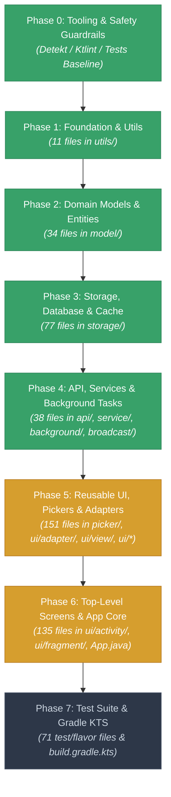

# 🚀 Cash Ledger: Pure Kotlin Migration Hub

<div align="center">


-blue?style=for-the-badge)

-3DDC84?style=for-the-badge&logo=android&logoColor=white)

</div>

---

## 📊 Live Progress Dashboard

> **How to update this dashboard:** Run `./gradlew updateMigrationTracker` (or [`scripts/Update-MigrationTracker.ps1`](scripts/Update-MigrationTracker.ps1)) to automatically recalculate counts, progress badges, statuses, Mermaid nodes, and file checklists from the codebase. CI also validates this in [`.github/workflows/build.yml`](.github/workflows/build.yml).

```
Total Files Migrated: [▓▓▓▓▓▓▓▓▓▓▓▓▓▓▓▓░░░░░░░░░░░░░░░░░░░░░░░░░░░░░░░░░░] 31.1% (161 / 517)
```

| Layer / Package | Description | Java Files | Kotlin Files | Total | Progress | Status | Target Sprint |
| :--- | :--- | :---: | :---: | :---: | :---: | :---: | :---: |
| **Phase 0: Tooling & Guardrails** | CI checks, detekt/ktlint, PR guidelines | — | — | — | 100% | 🟢 Completed | Sprint 1 |
| **Phase 1: Leaf Utilities** | `com...moneywallet.utils` | 0 | 11 | 11 | 100% | 🟢 Completed | Sprint 1–2 |
| **Phase 2: Domain Models** | `com...moneywallet.model` | 0 | 34 | 34 | 100% | 🟢 Completed | Sprint 2–3 |
| **Phase 3: Storage & Database** | `com...moneywallet.storage.*` | 0 | 77 | 77 | 100% | 🟢 Completed | Sprint 4–5 |
| **Phase 4: API, Service & Background**| `api`, `service`, `broadcast`, `background` | 0 | 38 | 38 | 100% | 🟢 Completed | Sprint 6–7 |
| **Phase 5: Reusable UI & Pickers** | `picker`, `ui/adapter`, `ui/view`, `ui/*` | 151 | 0 | 151 | 0% | 🟡 Ready to Start | Sprint 8–9 |
| **Phase 6: Top-Level Screens & App** | `ui/activity`, `ui/fragment`, `App.java` | 134 | 1 | 135 | 0.7% | 🟡 In Progress | Sprint 10–12 |
| **Phase 7: Test Suite & Gradle DSL** | `test`, `androidTest`, flavors, `.kts` | 71 | 0 | 71 | 0% | ⚪ Pending | Sprint 13 |
| **TOTALS** | **Entire Codebase** | **356** | **161** | **517** | **31.1%** | **🟡 Active** | **~13 Sprints** |

*(Note: 11 `utils/` files + 34 `model/` domain files + 77 `storage/` database & cache files + 38 Phase 4 files (`api/`, `background/`, `service/`, `broadcast/`) + `TutorialActivity.kt` are now pure Kotlin — 161 total).*

### 📢 Recent Activity & Milestones

- **2026-11-04 (Phase 0 Completed):** ✅ Configured Detekt 1.23.6 and detekt-formatting (Ktlint) in Gradle and CI. Enabled static check forbidding `!!` double-bang operators. Published [`docs/KOTLIN_GUIDELINES.md`](docs/KOTLIN_GUIDELINES.md).
- **2026-11-04 (Phase 1 Completed):** ✅ Migrated all 11 utility classes in `com.oriondev.moneywallet.utils` to idiomatic Kotlin (`Urls.kt`, `SystemBars.kt`, `DateUtils.kt`, `MoneyFormatter.kt`, `CurrencyManager.kt`, etc.).
- **2026-11-05 (Phase 2 Completed):** ✅ Migrated all 34 domain model and entity classes in `com.oriondev.moneywallet.model` to idiomatic Kotlin. Resolved JVM bytecode platform clashes, interface property overrides (`Identifiable.id`), `toString()` contracts, and database entity schema nullability.
- **2026-11-07 (Phase 3 Completed):** ✅ Migrated all 77 storage, database, preference, and cache classes in `com.oriondev.moneywallet.storage.*` to idiomatic Kotlin (`SQLDatabase.kt`, `DataContentProvider.kt`, `SyncContentProvider.kt`, preference managers, database serializers, etc.). Refactored query builders to `buildString` to eliminate compiler AST depth stack overflow bottlenecks, verified strict 0 double-bang (`!!`) compliance across the codebase, and verified 100% green in CI (all 662 unit tests passed, zero Detekt warnings, APK assembled).
- **2026-11-11 (Phase 4 Completed):** ✅ Migrated all 38 API, service, background loader, and broadcast receiver classes across `broadcast/` (7), `background/` (8), `api/` (13), and `service/` (10) to idiomatic Kotlin (`WebDAVClient.kt`, `SAFBackendServiceAPI.kt`, `DiskBackendServiceAPI.kt`, `OverviewDataLoader.kt`, `AutoBackupJobService.kt`, `BackupHandlerIntentService.kt`, `ImportExportIntentService.kt`, `RecurrenceHandlerIntentService.kt`, etc.). Applied `@JvmSuppressWildcards` on Java-facing loader `List` APIs, exposed `@JvmStatic` WebDAV helper methods for Java tests, shared foreground notification and backup locking helpers (`ForegroundServices.kt`, `TaskReporter.kt`, `BackupOperation.kt`), maintained strict 0 double-bang (`!!`) compliance and zero Detekt warnings, and verified 100% green in CI (run `43038888396`).
- **Next Target:** 🎯 **Phase 5: Reusable UI & Pickers** (151 classes across `picker/`, `ui/adapter/`, `ui/view/`, `ui/preference/`, `ui/widget/`, `ui/drawable/`, `ui/behavior/`, `ui/notification/`).

---

## 🗺️ Migration Architecture & Flow

To avoid the chaos of circular Java $\leftrightarrow$ Kotlin dependencies and runtime platform-type crashes (`T!`), we use a **Strict Bottom-Up (Dependency Leaves First)** strategy. Lower-level foundational code becomes pure Kotlin first; upper layers consume clean Kotlin types.



---

## ⏱️ Master Timeline & Hard Deadlines

> **Baseline Date:** November 04, 2026  
> **Accelerated Completion Target:** January 29, 2027 *(Accelerated by ~8 Weeks ahead of original March 26 schedule)*  
> **Total Effort:** ~12 Weeks (including verification and holiday buffer)


### 📅 Milestone Schedule Table

| Phase | Scope / Focus | File Count | Duration | Start Date | Hard Deadline | Exit Criteria / Status |
| :--- | :--- | :---: | :---: | :---: | :---: | :--- |
| **Phase 0** | Tooling, Detekt, CI Baseline | — | 1 Day | Nov 04, 2026 | **Nov 04, 2026** | 🟢 **Completed:** Detekt & ktlint enforced; CI safety baseline established. |
| **Phase 1** | Foundation & Leaf Utilities (`utils/`) | 11 | 1 Day | Nov 04, 2026 | **Nov 04, 2026** | 🟢 **Completed:** All 11 utility classes pure Kotlin; extension functions standardized. |
| **Phase 2** | Domain Models & Entities (`model/`) | 34 | 1 Day | Nov 05, 2026 | **Nov 05, 2026** | 🟢 **Completed:** 34 POJOs $\rightarrow$ immutable data classes; zero `!!`. |
| **Phase 3** | Storage, SQLite & ContentProvider (`storage/`) | 77 | 2 Days | Nov 06, 2026 | **Nov 07, 2026** | 🟢 **Completed:** SQLDatabase, DataContentProvider, Preferences, Caches (100% green CI). |
| **Phase 4** | Remote API, Services & Background | 38 | 3 Days | Nov 09, 2026 | **Nov 20, 2026** | 🟢 **Completed:** All 38 files across `api/`, `background/`, `service/`, `broadcast/` pure Kotlin (100% green CI). |
| **Phase 5** | Reusable UI, Pickers & Adapters | 151 | 3 Weeks | Nov 23, 2026 | **Dec 11, 2026** | 🟡 **Ready to Start:** Custom views, Pickers, RecyclerView Adapters & ViewHolders. |
| **Phase 6** | Top Screens, Fragments & App Core | 135 | 3.5 Weeks | Dec 14, 2026 | **Jan 08, 2027** | 🟡 **In Progress:** `TutorialActivity.kt` migrated (`1 / 135`); remaining Activities, Fragments, and `App.kt`. |
| **Phase 7** | Tests & Gradle Modernization (`.kts`) | 71 | 2 Weeks | Jan 11, 2027 | **Jan 22, 2027** | ⚪ **Pending:** 63 unit tests, 4 androidTests & 4 flavor sources (71 files); `.kts` DSL. |
| **Final** | **Release Verification & Smoke Test** | — | 1 Week | Jan 25, 2027 | **Jan 29, 2027** | ⚪ **Milestone:** **100% Pure Kotlin v2.2.0 Release Candidate tagged.** |

---

## 📜 Golden Rules of Migration

1. **The 2-Commit PR Rule:**
   - **Commit 1 (Mechanical J2K):** Run IDE converter or automated tool, resolve compile breaks only.
   - **Commit 2 (Idiomatic Polish):** Refactor to idiomatic Kotlin (data classes, expressions, nullability, extensions).
   - *Never mix logic changes/features into a migration PR.*
2. **Zero Force-Unwraps (`!!`):**
   - The use of `!!` is strictly banned in PRs. Use `requireNotNull()`, safe calls (`?.`), Elvis operator (`?:`), or smart casting.
3. **Pre-annotate Java:**
   - Before converting a Java class that interacts with other Java code, ensure public methods carry `@NonNull` / `@Nullable` annotations.
4. **Test-Driven Safety Net:**
   - Run `./gradlew testFlossOsmDebugUnitTest` before touching any package and verify all 63 unit test files pass after conversion.
5. **Preserve Headers & Attributions:**
   - Keep the original GPLv3 headers and author copyright comments intact on all converted files.

---

## 🔍 Detailed Phase-by-Phase Execution Guide

---

### Phase 0: Groundwork, Tooling & Safety Guardrails
**Dates:** Nov 04, 2026 &bull; **Deadline:** Nov 04, 2026 (1 Day) &bull; **Status:** 🟢 Completed

#### Objectives:
- Configure Kotlin static analysis to prevent bad habits from entering the codebase.
- Ensure all 63 Robolectric/JUnit unit test files run cleanly in CI and locally.

#### Action Items:
- [x] Add `detekt` and `detekt-formatting` (ktlint) to [`build.gradle`](build.gradle) and [`app/build.gradle`](app/build.gradle).
- [x] Configure lint rules to flag forbidden patterns (forbidding `!!` double-bang operators in [`config/detekt/detekt.yml`](config/detekt/detekt.yml)).
- [x] Establish automated test & detekt execution in [`.github/workflows/build.yml`](.github/workflows/build.yml).
- [x] Add automated tracker synchronization via [`scripts/Update-MigrationTracker.ps1`](scripts/Update-MigrationTracker.ps1) and `./gradlew updateMigrationTracker`.
- [x] Document developer PR guidelines for Kotlin contributions in [`docs/KOTLIN_GUIDELINES.md`](docs/KOTLIN_GUIDELINES.md).

---

### Phase 1: Leaf Utilities & Core Helpers
**Dates:** Nov 04, 2026 &bull; **Deadline:** Nov 04, 2026 (1 Day) &bull; **Files:** 11 Kotlin Files &bull; **Status:** 🟢 Completed
**Path:** `app/src/main/java/com/oriondev/moneywallet/utils/`

#### Why First?
These classes have no dependencies on the app's business domain or database. Converting them establishes Kotlin extension patterns used throughout the rest of the project.

#### Checklist:
- [x] `CurrencyManager.kt`
- [x] `DateFormatter.kt`
- [x] `DateUtils.kt`
- [x] `EquationSolver.kt`
- [x] `IconLoader.kt`
- [x] `MoneyFormatter.kt`
- [x] `ProgressInputStream.kt`
- [x] `ProgressOutputStream.kt`
- [x] `SystemBars.kt`
- [x] `Urls.kt` (Converted to singleton object with clean parser)
- [x] `Utils.kt` (Color palettes, permissions, view finders)

#### How We Do It:
Replace static helper methods with idiomatic Kotlin extension functions:

```kotlin
// ❌ Java static style:
Utils.formatDate(context, timestamp);

// ✅ Idiomatic Kotlin extension:
fun Long.toFormattedDate(context: Context): String { ... }
timestamp.toFormattedDate(context)
```

---

### Phase 2: Domain Models & Value Objects
**Dates:** Nov 05, 2026 &bull; **Deadline:** Nov 05, 2026 (1 Day) &bull; **Files:** 34 Kotlin Files &bull; **Status:** 🟢 Completed
**Path:** `app/src/main/java/com/oriondev/moneywallet/model/`

#### Why Second?
Models define the data contracts that the database, services, and UI exchange. Having clean Kotlin `data class`es with non-nullable fields drastically eliminates nullability ambiguity across the entire app.

#### Checklist:
- [x] `Attachment.kt`
- [x] `BackupService.kt`
- [x] `Category.kt`
- [x] `CategoryMoney.kt`
- [x] `ChangeLog.kt`
- [x] `ColorIcon.kt`
- [x] `Coordinates.kt`
- [x] `CurrencyUnit.kt`
- [x] `DataFormat.kt`
- [x] `Event.kt`
- [x] `Group.kt`
- [x] `Icon.kt`
- [x] `IconGroup.kt`
- [x] `Identifiable.kt` (Interface)
- [x] `IFile.kt` (Interface)
- [x] `License.kt`
- [x] `LocalFile.kt`
- [x] `LockMode.kt`
- [x] `Money.kt`
- [x] `MoneyScale.kt`
- [x] `OverviewData.kt`
- [x] `OverviewSetting.kt`
- [x] `Pair.kt` (Immutable data class `Pair<L, R>`)
- [x] `PeriodDetailFlowData.kt`
- [x] `PeriodDetailSummaryData.kt`
- [x] `PeriodMoney.kt`
- [x] `Person.kt`
- [x] `Place.kt`
- [x] `RecurrenceSetting.kt`
- [x] `SAFFile.kt`
- [x] `VectorIcon.kt`
- [x] `Wallet.kt`
- [x] `WalletAccount.kt`
- [x] `WebDAVFile.kt`

#### How We Do It:
Transform verbose Java POJOs into concise immutable Kotlin data classes:

```kotlin
// Before (Java): ~80 lines with getters, setters, constructors, equals, hashCode
// After (Kotlin):
data class Category(
    val id: Long = 0,
    val name: String,
    val icon: String? = null,
    val color: Int = 0,
    val parentId: Long? = null
) : Identifiable
```

---

### Phase 3: Storage, Database & Cache Layer
**Dates:** Nov 06, 2026 – Nov 07, 2026 &bull; **Deadline:** Nov 07, 2026 (2 Days) &bull; **Files:** 77 Kotlin Files &bull; **Status:** 🟢 Completed
**Path:** `app/src/main/java/com/oriondev/moneywallet/storage/`

#### Why Third?
Storage is the heart of Cash Ledger's offline-first architecture. It interfaces with SQLite, ContentProviders, Preferences, and Backup engines.

#### Sub-packages & Deliverables:
- [x] `storage/preference/` (9 files: `PreferenceManager.kt`, `BackendManager.kt`, `NotificationPreferenceManager.kt`, etc.)
- [x] `storage/cache/` (3 files: `IconCache.kt`, `ImageLoader.kt`, `PaletteCache.kt`)
- [x] `storage/database/` (52 files: `SQLDatabase.kt`, `DataContentProvider.kt`, `SyncContentProvider.kt`, `Contract.kt`, `Schema.kt`, builder classes, migration scripts)
- [x] `storage/database/backup/`, `legacy/`, `json/`, `qif/`, `csv/` (13 files: Importers, exporters, and backup serializers)

#### Highlights & Quality Criteria Achieved:
- **Zero Force-Unwraps:** Strictly 0 `!!` double-bang operators across all 77 classes, fully compliant with Detekt static rules.
- **Query Optimization:** Converted complex query builders in `SQLDatabase.kt` to `buildString { append(...) }`, avoiding Kotlin compiler frontend AST recursion depth limits.
- **Java Interoperability:** Retained full SAM and Java interop using functional interfaces (`Supplier<T>`, `Function<SQLDatabase, T>`) and `@JvmField` / `@JvmStatic` annotations.
- **Verified in CI:** 100% green test execution across all 662 unit tests, zero Detekt warnings, and successful APK assembly.

#### How We Do It:
- **Cursor Utilities:** Introduce extension functions to eliminate repetitive `cursor.getColumnIndex()` boilerplate and safely close resources:
  ```kotlin
  inline fun <T> Cursor.map(transform: (Cursor) -> T): List<T> = use {
      buildList { while (moveToNext()) add(transform(this@map)) }
  }
  
  fun Cursor.getStringOrNull(column: String): String? {
      val index = getColumnIndex(column)
      return if (index >= 0 && !isNull(index)) getString(index) else null
  }
  ```
- **SharedPreferences:** Use Kotlin property delegates instead of repetitive `getSharedPreferences().edit().put...()` calls.

---

### Phase 4: Remote API, Background Tasks & Services
**Dates:** Nov 09, 2026 – Nov 11, 2026 &bull; **Deadline:** Nov 20, 2026 (Completed 9 Days Early) &bull; **Files:** 38 Files (0 Java Remaining) &bull; **Status:** 🟢 Completed
**Path:** `api/`, `background/`, `service/`, `broadcast/`

#### Deliverables:
- [x] **Sub-phase 4A — Broadcast & Local Actions (`broadcast/`, 7 files):** `LocalAction.kt`, `Message.kt`, `BootBroadcastReceiver.kt`, `DailyBroadcastReceiver.kt`, `NotificationBroadcastReceiver.kt`, `AutoBackupBroadcastReceiver.kt`, `RecurrenceBroadcastReceiver.kt`.
- [x] **Sub-phase 4B — Loaders & Data Providers (`background/`, 8 files):** `AbstractGenericLoader.kt`, `JsonResourceLoader.kt`, `ChangeLogLoader.kt`, `LicenseLoader.kt`, `IconGroupLoader.kt`, `OverviewDataLoader.kt`, `PeriodDetailFlowLoader.kt`, `PeriodDetailSummaryLoader.kt`.
- [x] **Sub-phase 4C — Storage Backends & WebDAV API (`api/`, 13 files):** `BackendDescriptor.kt`, `BackendException.kt`, `IBackendServiceAPI.kt`, `AbstractBackendServiceAPI.kt`, `AbstractBackendServiceDelegate.kt`, `DiskBackendService.kt`, `DiskBackendServiceAPI.kt`, `SAFBackendService.kt`, `SAFBackendServiceAPI.kt`, `WebDAVException.kt`, `WebDAVBackendService.kt`, `WebDAVBackendServiceAPI.kt`, `WebDAVClient.kt` (OkHttp + XML PROPFIND client, SAF & local disk backends).
- [x] **Sub-phase 4D — Services & Workers (`service/`, 10 files):** `ForegroundServices.kt`, `TaskReporter.kt`, `BackupOperation.kt`, `AttachmentHandlerIntentService.kt`, `BackendHandlerIntentService.kt`, `AutoBackupJobService.kt`, `BackupHandlerIntentService.kt`, `RecurrenceHandlerIntentService.kt`, `ImportExportIntentService.kt`, `UpgradeLegacyEditionIntentService.kt` (`IntentService`, `JobIntentService`, and `JobService` background workers).

#### Highlights & Implementation Notes:
- **Zero `!!` & Strict Static Analysis:** All 38 files comply with Detekt 1.23.6 and ktlint formatting rules with zero `!!` double-bang operators.
- **Java Interoperability:** Added `@JvmSuppressWildcards` on loader `List` return types (`ChangeLogLoader.kt`, `LicenseLoader.kt`, `IconGroupLoader.kt`), exposed unmangled `@JvmStatic` WebDAV helper methods on `WebDAVClient.kt` for Java unit tests, retained `protected` override visibility on `ImportExportIntentService.onHandleIntent` for same-package unit tests, and accessed `BackendException.isRecoverable` as a Kotlin property.
- **Consolidated Service Helpers:** Shared foreground notification setup via `ForegroundServices.kt`, extracted progress callback reporting via `TaskReporter.kt` (`fun interface`), and centralized serialized backup locking via `BackupOperation.kt` — verified green in GitHub Actions CI run `43038888396`.

---

### Phase 5: Reusable UI, Pickers & Adapters
**Dates:** Nov 23, 2026 – Dec 11, 2026 &bull; **Deadline:** Dec 11, 2026 (3 Weeks) &bull; **Files:** 151 Java Files &bull; **Status:** 🟡 Ready to Start
**Path:** `picker/`, `ui/adapter/`, `ui/view/`, `ui/behavior/`, `ui/drawable/`, `ui/notification/`, `ui/preference/`, `ui/widget/`

#### Key Components:
- **`picker/` (16 files):** Color, Icon, Date/Time, Currency, Wallet, and Category pickers.
- **`ui/adapter/` (48 files):** RecyclerView and ViewPager adapters for transactions, categories, wallets, currencies.
- **`ui/view/` (73 files):** Custom charts, calendar strips, theme widgets, and custom input widgets.
- **`ui/behavior/`, `ui/drawable/`, `ui/notification/`, `ui/preference/`, `ui/widget/` (14 files):** Scroll behavior (`1`), custom drawables (`2`), notification helper (`1`), preference controls (`6`), and app widgets (`4`).

#### How We Do It:
- Clean up RecyclerView Adapters using Kotlin property delegates and lambda click listeners:
  ```kotlin
  class WalletAdapter(
      private val onWalletClicked: (Wallet) -> Unit
  ) : ListAdapter<Wallet, WalletViewHolder>(WalletDiffCallback) { ... }
  ```
- Eliminate `findViewById` where possible (or adopt ViewBinding if enabled in `app/build.gradle`).

---

### Phase 6: Top-Level Screens & Application Core
**Dates:** Dec 14, 2026 – Jan 08, 2027 &bull; **Deadline:** Jan 08, 2027 (3.5 Weeks) &bull; **Files:** 135 Files (`1` Kotlin, `134` Java) &bull; **Status:** 🟡 In Progress
**Path:** `ui/activity/` (`50`), `ui/fragment/` (`84`), `App.java` (`1`)

#### Status:
- [x] `TutorialActivity.kt` *(Already converted)*
- [ ] `LauncherActivity.java`
- [ ] `MainActivity.java`
- [ ] `LockActivity.java`
- [ ] `TransactionListActivity.java`
- [ ] `WalletListActivity.java`
- [ ] `CalendarActivity.java`
- [ ] `MapActivity.java`
- [ ] `PeriodDetailActivity.java`
- [ ] `CurrencyListActivity.java`
- [ ] `CalculatorActivity.java`
- [ ] `NewEditTransactionActivity.java`
- [ ] `NewEditTransferActivity.java`
- [ ] `NewEditWalletActivity.java`
- [ ] `NewEditCategoryActivity.java`
- [ ] `NewEditBudgetActivity.java`
- [ ] `NewEditCurrencyActivity.java`
- [ ] `NewEditDebtActivity.java`
- [ ] `NewEditSavingActivity.java`
- [ ] `NewEditEventActivity.java`
- [ ] `NewEditItemActivity.java`
- [ ] `NewEditPlaceActivity.java`
- [ ] `NewEditPersonActivity.java`
- [ ] `NewEditRecurrentTransactionActivity.java`
- [ ] `NewEditRecurrentTransferActivity.java`
- [ ] `NewEditTransactionModelActivity.java`
- [ ] `NewEditTransferModelActivity.java`
- [ ] `CategoryPickerActivity.java`
- [ ] `CategorySortActivity.java`
- [ ] `CategoryRuleListActivity.java`
- [ ] `NewEditCategoryRuleActivity.java`
- [ ] `CategoryRuleSortActivity.java`
- [ ] `WalletSortActivity.java`
- [ ] `IconListActivity.java`
- [ ] `SearchActivity.java`
- [ ] `ImportExportActivity.java`
- [ ] `BackupListActivity.java`
- [ ] `BackendExplorerActivity.java`
- [ ] `AboutActivity.java`
- [ ] `DrawerController.java`
- [ ] `ToolbarController.java`
- [ ] `TransactionEditorRules.java`
- [ ] `BaseActivity.java` *(in `ui/activity/base/`)*
- [ ] `ThemedActivity.java` *(in `ui/activity/base/`)*
- [ ] `SinglePanelActivity.java` *(in `ui/activity/base/`)*
- [ ] `SinglePanelAppBarActivity.java` *(in `ui/activity/base/`)*
- [ ] `SinglePanelScrollActivity.java` *(in `ui/activity/base/`)*
- [ ] `SinglePanelSimpleListActivity.java` *(in `ui/activity/base/`)*
- [ ] `SinglePanelViewPagerActivity.java` *(in `ui/activity/base/`)*
- [ ] `MultiPanelActivity.java` *(in `ui/activity/base/`)*
- [ ] All `84` files under `ui/fragment/`
- [ ] `App.java`

#### How We Do It:
- Convert base activities (`ui/activity/base/`), screen activities, and fragments (`ui/fragment/`) in logical pairs with their dialogs.
- `App.java` converts last in this phase once all underlying singletons and dependencies are in Kotlin.

---

### Phase 7: Test Suite & Gradle Modernization
**Dates:** Jan 11, 2027 – Jan 22, 2027 &bull; **Deadline:** Jan 22, 2027 (2 Weeks) &bull; **Files:** 71 Java Files &bull; **Status:** ⚪ Pending

#### Objectives:
- Convert all `63` unit tests in `app/src/test/`, `4` instrumentation tests in `app/src/androidTest/`, `1` `floss` flavor file (`app/src/floss/`), and `3` `osm` flavor files (`app/src/osm/`) to pure Kotlin.
- Migrate root [`build.gradle`](build.gradle) and [`app/build.gradle`](app/build.gradle) from Groovy to Kotlin DSL (`build.gradle.kts`).
- Retain strict Kotlin compiler flags (`-Xjvm-default=all` and `-Xskip-metadata-version-check` are already active in [`app/build.gradle`](app/build.gradle)):
  ```kotlin
  compilerOptions {
      freeCompilerArgs.addAll(
          "-Xjvm-default=all",
          "-opt-in=kotlin.RequiresOptIn"
      )
  }
  ```

---

## 🛠️ Contributor Workflow: How to Pick Up a Task

1. **Pick a file or package** from the lowest unfinished phase in the dashboard.
2. **Create a feature branch:**
   ```bash
   git checkout -b migrate/phase-5-pickers
   ```
3. **Run existing tests to establish a clean baseline:**
   ```bash
   ./gradlew testFlossOsmDebugUnitTest
   ```
4. **Convert following the 2-commit rule:**
   - Commit 1: Mechanical conversion (syntax & compilation only).
   - Commit 2: Idiomatic Kotlin refactoring (clean nullability, data classes, expressions).
5. **Verify:**
   ```bash
   ./gradlew testFlossOsmDebugUnitTest lintFlossOsmDebug assembleFlossOsmDebug
   ./gradlew detekt
   ```
6. **Update this document (`KOTLIN_MIGRATION.mdx`):**
   - Run `./gradlew updateMigrationTracker` (or [`scripts/Update-MigrationTracker.ps1`](scripts/Update-MigrationTracker.ps1)) to sync table metrics, progress bars, statuses, and checklists automatically.
   - Add milestone notes where appropriate.
7. **Open PR:** Title as `[Kotlin Migration] Migrate <Package/Files> (Phase X)`.

---

*This document is maintained as the single source of truth for Cash Ledger's pure Kotlin transition.*

