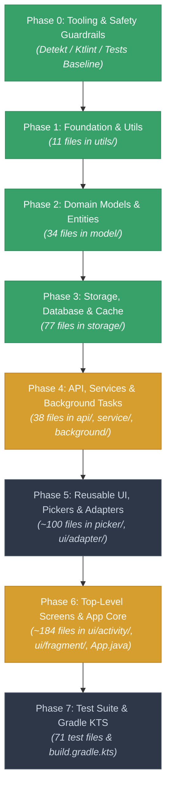
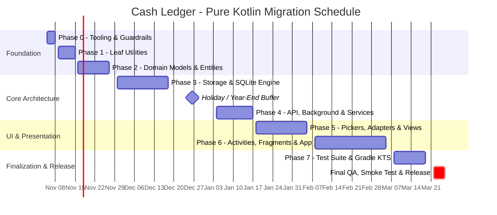

# 🚀 Cash Ledger: Pure Kotlin Migration Hub

<div align="center">


-blue?style=for-the-badge)

-3DDC84?style=for-the-badge&logo=android&logoColor=white)

</div>

---

## 📊 Live Progress Dashboard

> **How to update this dashboard:** When a PR lands that converts files, update the counts in the table below and bump the progress badges above.

```
Total Files Migrated: [▓▓▓▓▓▓▓▓▓▓▓▓░░░░░░░░░░░░░░░░░░░░░░░░░░░░░░░░░░░░░░] 23.8% (123 / 517)
```

| Layer / Package | Description | Java Files | Kotlin Files | Total | Progress | Status | Target Sprint |
| :--- | :--- | :---: | :---: | :---: | :---: | :---: | :---: |
| **Phase 0: Tooling & Guardrails** | CI checks, detekt/ktlint, PR guidelines | — | — | — | 100% | 🟢 Completed | Sprint 1 |
| **Phase 1: Leaf Utilities** | `com...moneywallet.utils` | 0 | 11 | 11 | 100% | 🟢 Completed | Sprint 1–2 |
| **Phase 2: Domain Models** | `com...moneywallet.model` | 0 | 34 | 34 | 100% | 🟢 Completed | Sprint 2–3 |
| **Phase 3: Storage & Database** | `com...moneywallet.storage.*` | 0 | 77 | 77 | 100% | 🟢 Completed | Sprint 4–5 |
| **Phase 4: API, Service & Background**| `api`, `service`, `broadcast`, `background` | 38 | 0 | 38 | 0% | 🟡 Ready to Start | Sprint 6–7 |
| **Phase 5: Reusable UI & Pickers** | `picker`, `ui/adapter`, `ui/view` | 151 | 0 | 151 | 0% | ⚪ Pending | Sprint 8–9 |
| **Phase 6: Top-Level Screens & App** | `ui/activity`, `ui/fragment`, `App.java` | 134 | 1 | 135 | 0.7% | 🟡 In Progress | Sprint 10–12 |
| **Phase 7: Test Suite & Gradle DSL** | `app/src/test`, `build.gradle.kts` | 71 | 0 | 71 | 0% | ⚪ Pending | Sprint 13 |
| **TOTALS** | **Entire Codebase** | **394** | **123** | **517** | **23.8%** | **🟡 Active** | **~13 Sprints** |

*(Note: `TutorialActivity.kt` + 11 `utils/` files + 34 `model/` domain files are now pure Kotlin).*

### 📢 Recent Activity & Milestones

- **2026-11-04 (Phase 0 Completed):** ✅ Configured Detekt 1.23.6 and detekt-formatting (Ktlint) in Gradle and CI. Enabled static check forbidding `!!` double-bang operators. Published [`docs/KOTLIN_GUIDELINES.md`](docs/KOTLIN_GUIDELINES.md).
- **2026-11-04 (Phase 1 Completed):** ✅ Migrated all 11 utility classes in `com.oriondev.moneywallet.utils` to idiomatic Kotlin (`Urls.kt`, `SystemBars.kt`, `DateUtils.kt`, `MoneyFormatter.kt`, `CurrencyManager.kt`, etc.).
- **2026-11-05 (Phase 2 Completed):** ✅ Migrated all 34 domain model and entity classes in `com.oriondev.moneywallet.model` to idiomatic Kotlin. Resolved JVM bytecode platform clashes, interface property overrides (`Identifiable.id`), `toString()` contracts, and database entity schema nullability. Verified 100% green in CI (662/662 tests passed, zero Detekt warnings, APK assembled).
- **Next Target:** 🎯 **Phase 3: Storage, Database & Cache** (77 classes in `app/src/main/java/com/oriondev/moneywallet/storage/`).

---

## 🗺️ Migration Architecture & Flow

To avoid the chaos of circular Java $\leftrightarrow$ Kotlin dependencies and runtime platform-type crashes (`T!`), we use a **Strict Bottom-Up (Dependency Leaves First)** strategy. Lower-level foundational code becomes pure Kotlin first; upper layers consume clean Kotlin types.



---

## ⏱️ Master Timeline & Hard Deadlines

> **Baseline Date:** November 5, 2026  
> **Target Completion Date:** March 26, 2027  
> **Total Effort:** ~14 Weeks (including QA, testing, and buffer)



### 📅 Milestone Schedule Table

| Phase | Scope / Focus | File Count | Duration | Start Date | Hard Deadline | Exit Criteria / Deliverables |
| :--- | :--- | :---: | :---: | :---: | :---: | :--- |
| **Phase 0** | Tooling, Detekt, CI Baseline | — | 3 Days | Nov 05, 2026 | **Nov 08, 2026** | Detekt & ktlint enforced; `./gradlew test` green. |
| **Phase 1** | Foundation & Leaf Utilities (`utils/`) | 11 | 1 Week | Nov 09, 2026 | **Nov 15, 2026** | All 11 utility classes pure Kotlin; extension functions standardized. |
| **Phase 2** | Domain Models & Entities (`model/`) | 34 | 1.5 Weeks | Nov 16, 2026 | **Nov 27, 2026** | 34 POJOs $\rightarrow$ immutable `data class`es with default arguments. |
| **Phase 3** | Storage, SQLite & ContentProvider | 77 | 3 Weeks | Nov 30, 2026 | **Dec 18, 2026** | SQLite schemas, Cursor extensions, preference delegates complete. |
| *Break* | *Year-End Buffer / Stabilization* | — | 2 Weeks | Dec 19, 2026 | **Jan 03, 2027** | Regressions checked; no open blocker issues. |
| **Phase 4** | Remote API, Services & Background | 38 | 2 Weeks | Jan 04, 2027 | **Jan 17, 2027** | Handlers/AsyncTasks $\rightarrow$ Coroutines (`suspend fun`); OkHttp clean. |
| **Phase 5** | Reusable UI, Pickers & Adapters | ~100 | 2.5 Weeks | Jan 18, 2027 | **Feb 05, 2027** | All RecyclerView Adapters, ViewHolders, and Pickers pure Kotlin. |
| **Phase 6** | Top Screens, Fragments & App Core | ~184 | 3.5 Weeks | Feb 08, 2027 | **Mar 05, 2027** | All Activities, Fragments, and `App.kt` converted (Zero Java in main). |
| **Phase 7** | Tests & Gradle DSL (`.kts`) | 71 | 1.5 Weeks | Mar 08, 2027 | **Mar 19, 2027** | 63 tests converted; root and app `build.gradle.kts` in Kotlin DSL. |
| **Final** | **Release Verification & Smoke Test** | — | 1 Week | Mar 22, 2027 | **Mar 26, 2027** | **100% Pure Kotlin v2.2.0 Release Candidate tagged.** |

---

## 📜 Golden Rules of Migration

1. **The 2-Commit PR Rule:**
   - **Commit 1 (Mechanical J2K):** Run IDE converter or automated tool, resolve compile breaks only.
   - **Commit 2 (Idiomatic Polish):** Refactor to idiomatic Kotlin (data classes, expressions, nullability, extensions).
   - *Never mix logic changes/features into a migration PR.*
2. **Zero Force-Unwraps (`!!`):**
   - The use of `!!` is strictly banned in PRs. Use `requireNotNull()`, safe calls (`?.`), Elvis operator (`?:`), or smart casting.
3. **Pre-annotate Java:**
   - Before converting a Java class that interacts with other Java code, ensure public methods carry `@NonNull` / `@Nullable` annotations.
4. **Test-Driven Safety Net:**
   - Run `./gradlew test` before touching any package and verify all 63 unit tests pass after conversion.
5. **Preserve Headers & Attributions:**
   - Keep the original GPLv3 headers and author copyright comments intact on all converted files.

---

## 🔍 Detailed Phase-by-Phase Execution Guide

---

### Phase 0: Groundwork, Tooling & Safety Guardrails
**Dates:** Nov 05, 2026 – Nov 08, 2026 &bull; **Deadline:** Nov 08, 2026 (3 Days) &bull; **Status:** 🟢 Completed

#### Objectives:
- Configure Kotlin static analysis to prevent bad habits from entering the codebase.
- Ensure the 63 Robolectric/JUnit tests run cleanly in CI and locally.

#### Action Items:
- [x] Add `detekt` and `detekt-formatting` (ktlint) to [`build.gradle`](build.gradle) and [`app/build.gradle`](app/build.gradle).
- [x] Configure lint rules to flag forbidden patterns (forbidding `!!` double-bang operators in [`config/detekt/detekt.yml`](config/detekt/detekt.yml)).
- [x] Establish automated test & detekt execution in [`.github/workflows/build.yml`](.github/workflows/build.yml).
- [x] Document developer PR guidelines for Kotlin contributions in [`docs/KOTLIN_GUIDELINES.md`](docs/KOTLIN_GUIDELINES.md).

---

### Phase 1: Leaf Utilities & Core Helpers
**Dates:** Nov 09, 2026 – Nov 15, 2026 &bull; **Deadline:** Nov 15, 2026 (1 Week) &bull; **Files:** 11 Kotlin Files &bull; **Status:** 🟢 Completed
**Path:** `app/src/main/java/com/oriondev/moneywallet/utils/`

#### Why First?
These classes have no dependencies on the app's business domain or database. Converting them establishes Kotlin extension patterns used throughout the rest of the project.

#### Checklist:
- [x] `CurrencyManager.kt`
- [x] `DateFormatter.kt`
- [x] `DateUtils.kt`
- [x] `EquationSolver.kt`
- [x] `IconLoader.kt`
- [x] `MoneyFormatter.kt`
- [x] `ProgressInputStream.kt`
- [x] `ProgressOutputStream.kt`
- [x] `SystemBars.kt`
- [x] `Urls.kt` (Converted to singleton object with clean parser)
- [x] `Utils.kt` (Color palettes, permissions, view finders)

#### How We Do It:
Replace static helper methods with idiomatic Kotlin extension functions:

```kotlin
// ❌ Java static style:
Utils.formatDate(context, timestamp);

// ✅ Idiomatic Kotlin extension:
fun Long.toFormattedDate(context: Context): String { ... }
timestamp.toFormattedDate(context)
```

---

### Phase 2: Domain Models & Value Objects
**Dates:** Nov 16, 2026 – Nov 27, 2026 &bull; **Deadline:** Nov 27, 2026 (1.5 Weeks) &bull; **Files:** 34 Java Files &bull; **Status:** 🟢 Completed
**Path:** `app/src/main/java/com/oriondev/moneywallet/model/`

#### Why Second?
Models define the data contracts that the database, services, and UI exchange. Having clean Kotlin `data class`es with non-nullable fields drastically eliminates nullability ambiguity across the entire app.

#### Checklist:
- [x] `Attachment.kt`
- [x] `BackupService.kt`
- [x] `Category.kt`
- [x] `CategoryMoney.kt`
- [x] `ChangeLog.kt`
- [x] `ColorIcon.kt`
- [x] `Coordinates.kt`
- [x] `CurrencyUnit.kt`
- [x] `DataFormat.kt`
- [x] `Event.kt`
- [x] `Group.kt`
- [x] `Icon.kt`
- [x] `IconGroup.kt`
- [x] `Identifiable.kt` (Interface)
- [x] `IFile.kt` (Interface)
- [x] `License.kt`
- [x] `LocalFile.kt`
- [x] `LockMode.kt`
- [x] `Money.kt`
- [x] `MoneyScale.kt`
- [x] `OverviewData.kt`
- [x] `OverviewSetting.kt`
- [x] `Pair.kt` (Replace with Kotlin's built-in `Pair<A, B>`)
- [x] `PeriodDetailFlowData.kt`
- [x] `PeriodDetailSummaryData.kt`
- [x] `PeriodMoney.kt`
- [x] `Person.kt`
- [x] `Place.kt`
- [x] `RecurrenceSetting.kt`
- [x] `SAFFile.kt`
- [x] `VectorIcon.kt`
- [x] `Wallet.kt`
- [x] `WalletAccount.kt`
- [x] `WebDAVFile.kt`

#### How We Do It:
Transform verbose Java POJOs into concise immutable Kotlin data classes:

```kotlin
// Before (Java): ~80 lines with getters, setters, constructors, equals, hashCode
// After (Kotlin):
data class Category(
    val id: Long = 0,
    val name: String,
    val icon: String? = null,
    val color: Int = 0,
    val parentId: Long? = null
) : Identifiable
```

---

### Phase 3: Storage, Database & Cache Layer
**Dates:** Nov 30, 2026 – Dec 18, 2026 &bull; **Deadline:** Dec 18, 2026 (3 Weeks) &bull; **Files:** 77 Java Files &bull; **Status:** 🟢 Completed
**Path:** `app/src/main/java/com/oriondev/moneywallet/storage/`

#### Why Third?
Storage is the heart of Cash Ledger's offline-first architecture. It interfaces with SQLite, ContentProviders, Preferences, and Backup engines.

#### Sub-packages:
1. `storage/preference/`: Preference managers and setting wrappers.
2. `storage/cache/`: Memory and disk cache helpers.
3. `storage/database/`:
   - `Contract.java`: Table and column definitions.
   - `Schema.java` & `SQLDatabase.java`: Database helper and migration scripts.
   - `DataContentProvider.java`: ContentProvider implementation.
   - `TransactionContentValuesBuilder.java`, `TransferContentValuesBuilder.java`.
4. `storage/database/backup/`, `legacy/`, `json/`: Importers and exporters (WebDAV, ZIP, JSON).

#### How We Do It:
- **Cursor Utilities:** Introduce extension functions to eliminate repetitive `cursor.getColumnIndex()` boilerplate and safely close resources:
  ```kotlin
  inline fun <T> Cursor.map(transform: (Cursor) -> T): List<T> = use {
      buildList { while (moveToNext()) add(transform(this@map)) }
  }
  
  fun Cursor.getStringOrNull(column: String): String? {
      val index = getColumnIndex(column)
      return if (index >= 0 && !isNull(index)) getString(index) else null
  }
  ```
- **SharedPreferences:** Use Kotlin property delegates instead of repetitive `getSharedPreferences().edit().put...()` calls.

---

### Phase 4: Remote API, Background Tasks & Services
**Dates:** Jan 04, 2027 – Jan 17, 2027 &bull; **Deadline:** Jan 17, 2027 (2 Weeks) &bull; **Files:** 38 Java Files &bull; **Status:** 🟡 Ready to Start
**Path:** `api/`, `background/`, `service/`, `broadcast/`

#### Key Components:
- **`api/` (13 files):** Remote currency exchange rate clients (OkHttp integration).
- **`background/` (8 files):** Asynchronous tasks and workers.
- **`service/` (10 files):** Android background services (BackupService, AutoBackupService).
- **`broadcast/` (7 files):** System event listeners and alarms.

#### How We Do It:
- Replace Java `Thread`, `Handler`, and callback interfaces with **Kotlin Coroutines** (`suspend fun`, `Dispatchers.IO`).
- Simplify OkHttp network calls using Kotlin extension functions and coroutine adapters.

---

### Phase 5: Reusable UI, Pickers & Adapters
**Dates:** Jan 18, 2027 – Feb 05, 2027 &bull; **Deadline:** Feb 05, 2027 (2.5 Weeks) &bull; **Files:** ~100 Java Files &bull; **Status:** ⚪ Pending
**Path:** `picker/`, `ui/adapter/`, `ui/view/`

#### Key Components:
- **`picker/` (16 files):** Color picker, Icon picker, Date/Time pickers.
- **`ui/adapter/` (~40 files):** RecyclerView adapters for transactions, categories, wallets, currencies.
- **`ui/view/` (~40 files):** Custom charts, graph wrappers, custom input widgets.

#### How We Do It:
- Clean up RecyclerView Adapters using Kotlin property delegates and lambda click listeners:
  ```kotlin
  class WalletAdapter(
      private val onWalletClicked: (Wallet) -> Unit
  ) : ListAdapter<Wallet, WalletViewHolder>(WalletDiffCallback) { ... }
  ```
- Eliminate `findViewById` where possible by adopting Android **ViewBinding**.

---

### Phase 6: Top-Level Screens & Application Core
**Dates:** Feb 08, 2027 – Mar 05, 2027 &bull; **Deadline:** Mar 05, 2027 (3.5 Weeks) &bull; **Files:** ~184 Java Files &bull; **Status:** 🟡 In Progress
**Path:** `ui/activity/`, `ui/fragment/`, `App.java`

#### Status:
- [x] `TutorialActivity.kt` *(Already converted)*
- [ ] `LauncherActivity.java`
- [ ] `MainActivity.java`
- [ ] `LockActivity.java`
- [ ] `TransactionListActivity.java`
- [ ] `WalletListActivity.java`
- [ ] `CalendarActivity.java`
- [ ] `MapActivity.java`
- [ ] `PeriodDetailActivity.java`
- [ ] `CurrencyListActivity.java`
- [ ] `NewEditTransactionActivity.java`
- [ ] `NewEditTransferActivity.java`
- [ ] `NewEditWalletActivity.java`
- [ ] `NewEditCategoryActivity.java`
- [ ] `NewEditBudgetActivity.java`
- [ ] `NewEditDebtActivity.java`
- [ ] `NewEditSavingActivity.java`
- [ ] `NewEditEventActivity.java`
- [ ] `NewEditPlaceActivity.java`
- [ ] `NewEditPersonActivity.java`
- [ ] `NewEditRecurrentTransactionActivity.java`
- [ ] `NewEditTransactionModelActivity.java`
- [ ] `SettingsActivity.java`
- [ ] `CategoryPickerActivity.java`
- [ ] `CategorySortActivity.java`
- [ ] `CategoryRuleListActivity.java`
- [ ] `NewEditCategoryRuleActivity.java`
- [ ] `CategoryRuleSortActivity.java`
- [ ] `WalletSortActivity.java`
- [ ] `IconListActivity.java`
- [ ] `PlacePickerActivity.java`
- [ ] `SearchActivity.java`
- [ ] `ImportExportActivity.java`
- [ ] `BackupListActivity.java`
- [ ] `BackendExplorerActivity.java`
- [ ] `AboutActivity.java`
- [ ] All Fragments under `ui/fragment/`
- [ ] `App.java`

#### How We Do It:
- Convert Activities and Fragments in logical pairs with their dialogs.
- `App.java` converts last in this phase once all underlying singletons and dependencies are in Kotlin.

---

### Phase 7: Test Suite & Gradle Modernization
**Dates:** Mar 08, 2027 – Mar 19, 2027 &bull; **Deadline:** Mar 19, 2027 (1.5 Weeks) &bull; **Files:** 71 Java Files &bull; **Status:** ⚪ Pending

#### Objectives:
- Convert all 63 unit tests in `app/src/test/` to pure Kotlin.
- Migrate root [`build.gradle`](build.gradle) and [`app/build.gradle`](app/build.gradle) from Groovy to Kotlin DSL (`build.gradle.kts`).
- Enable strict Kotlin compiler flags:
  ```kotlin
  freeCompilerArgs += listOf(
      "-Xjvm-default=all",
      "-opt-in=kotlin.RequiresOptIn"
  )
  ```

---

## 🛠️ Contributor Workflow: How to Pick Up a Task

1. **Pick a file or package** from the lowest unfinished phase in the dashboard.
2. **Create a feature branch:**
   ```bash
   git checkout -b migrate/phase-1-utils
   ```
3. **Run existing tests to establish a clean baseline:**
   ```bash
   ./gradlew test
   ```
4. **Convert following the 2-commit rule:**
   - Commit 1: Mechanical conversion (syntax & compilation only).
   - Commit 2: Idiomatic Kotlin refactoring (clean nullability, data classes, expressions).
5. **Verify:**
   ```bash
   ./gradlew test
   ./gradlew lint
   ```
6. **Update this document (`KOTLIN_MIGRATION.mdx`):**
   - Check the boxes `[x]` for your converted files.
   - Increment the file count and update the progress percentage.
7. **Open PR:** Title as `[Kotlin Migration] Migrate <Package/Files> (Phase X)`.

---

*This document is maintained as the single source of truth for Cash Ledger's pure Kotlin transition.*

