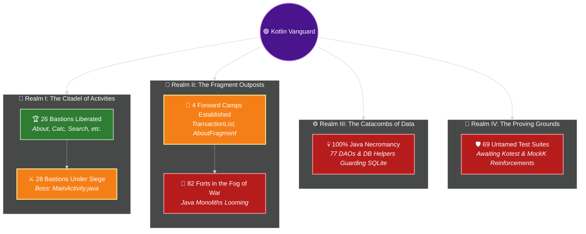
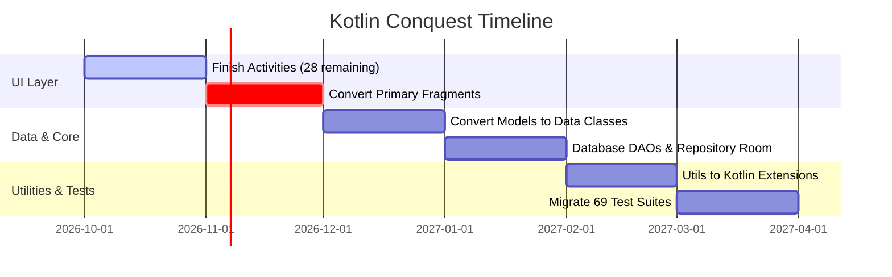

# 🚀 The Great Java-to-Kotlin Migration Chronicles ☕➡️🟣

> *"There are two types of developers: those who migrate to Kotlin, and those who spend their weekends debugging `NullPointerException`."* — *Ancient Android Proverb*

---

## 📊 1. The High-Level Battle Ground

We ran the scouters over the codebase, and here is the pulse check of our crusade against semicolon tyranny:

```
Total Files Analyzed : 529
Java Holdouts (☕)    : 492 files (93.0%)
Kotlin Chads  (🟣)   :  37 files  (7.0%)
```

### 🥧 The Codebase Pie Chart


---

## 🗺️ 2. Domain-by-Domain Progress: *The Conquest of CashLedger*



### ⚔️ Realm Status Log & Boss Encounters

#### 🏰 Realm I: The Citadel of Activities (UI Frontline)
* **Liberation Progress**: `[██████████░░░░░░░░░░]` **48.1%**
* **Status**: ⚔️ **HEATED SIEGE**
* **Garrison**: `26` Kotlin Knights vs `28` Java Defenders
* **Current Boss Fight**: `MainActivity.java` *(HP: 950 Lines | Special Attack: Intent Spam)*
* **Loot Upon Victory**: `+50 Null Safety`, `-420 Semicolons`

#### 🧩 Realm II: The Fragment Outposts (Component Layer)
* **Liberation Progress**: `[█░░░░░░░░░░░░░░░░░░░]` **4.7%**
* **Status**: 🏹 **SCOUTING PARTY ADVANCING**
* **Garrison**: `4` Kotlin Scouts
* **Objective**: Infiltrate primary balance & summary tabs without triggering `IllegalStateException: Fragment not attached`

#### 💀 Realm III: The Catacombs of Data & DAOs (Storage Depths)
* **Liberation Progress**: `[░░░░░░░░░░░░░░░░░░░░]` **0.0%**
* **Status**: 🔒 **ANCIENT JAVA CITADEL**
* **Threat Level**: 🌋 *Extreme*
* **Dungeon Bosses**: `WalletDAO.java`, `TransactionDatabase.java`, `MWBackupImporter.java`
* **Debuff**: Every query incurs +5 verbose cursors and manual index mappings

#### 🧪 Realm IV: The Proving Grounds (Test Suite)
* **Liberation Progress**: `[█░░░░░░░░░░░░░░░░░░░]` **2.9%**
* **Status**: ⏳ **PEACEFUL STALEMATE**
* **Roster**: `67` Unit Tests + `2` Android Instrumented Tests
* **Strategy**: Deploy modern Kotlin DSL assertions & coroutine test scopes once the battle moves deeper

---

## 🔥 3. Kotlin Migration Heat Map

Visual progress status across different modules:

| Module / Package | Kotlin | Java | Progress | Risk Level | Status Heatmap |
| :--- | :---: | :---: | :---: | :---: | :--- |
| **`ui/activity`** | 26 | 28 | **48.1%** | 🟡 Medium | `🟩🟩🟩🟩🟨🟥🟥🟥🟥🟥` *Civil War in Progress* |
| **`ui/fragment`** | 4 | 82 | **4.7%** | 🟠 High | `🟨🟥🟥🟥🟥🟥🟥🟥🟥🟥` *Reconnaissance Mission* |
| **`updater`** | 2 | 0 | **100.0%** | 🟢 Safe | `🟩🟩🟩🟩🟩🟩🟩🟩🟩🟩` *Liberated Territory* 🏆 |
| **`model`** | 1 | 60 | **1.6%** | 🔴 Extreme | `🟨🟥🟥🟥🟥🟥🟥🟥🟥🟥` *Getters & Setters Everywhere* |
| **`storage/database`**| 0 | 77 | **0.0%** | 💀 Critical | `🟥🟥🟥🟥🟥🟥🟥🟥🟥🟥` *The Semicolon Citadel* |
| **`utils`** | 0 | 11 | **0.0%** | 🔴 High | `🟥🟥🟥🟥🟥🟥🟥🟥🟥🟥` *Static Class Graveyard* |
| **`service & background`**| 0 | 18 | **0.0%** | 🟠 High | `🟥🟥🟥🟥🟥🟥🟥🟥🟥🟥` *Background Boilerplate* |
| **`tests (src/test)`** | 2 | 67 | **2.9%** | 🟡 Medium | `🟨🟥🟥🟥🟥🟥🟥🟥🟥🟥` *Legacy Assertions* |

---

## 🏆 4. Hall of Fame (Converted Kotlin Files)

These brave `37` files threw away the Java syntax baggage:

### 👑 Activities
* [AboutActivity.kt](https://github.com/solomonrajan/cashledger/blob/javatokotlin/app/src/main/java/com/oriondev/moneywallet/ui/activity/AboutActivity.kt)
* [BackendExplorerActivity.kt](https://github.com/solomonrajan/cashledger/blob/javatokotlin/app/src/main/java/com/oriondev/moneywallet/ui/activity/BackendExplorerActivity.kt)
* [BackupListActivity.kt](https://github.com/solomonrajan/cashledger/blob/javatokotlin/app/src/main/java/com/oriondev/moneywallet/ui/activity/BackupListActivity.kt)
* [CalculatorActivity.kt](https://github.com/solomonrajan/cashledger/blob/javatokotlin/app/src/main/java/com/oriondev/moneywallet/ui/activity/CalculatorActivity.kt)
* [CalendarActivity.kt](https://github.com/solomonrajan/cashledger/blob/javatokotlin/app/src/main/java/com/oriondev/moneywallet/ui/activity/CalendarActivity.kt)
* [CategoryPickerActivity.kt](https://github.com/solomonrajan/cashledger/blob/javatokotlin/app/src/main/java/com/oriondev/moneywallet/ui/activity/CategoryPickerActivity.kt)
* [CategoryRuleListActivity.kt](https://github.com/solomonrajan/cashledger/blob/javatokotlin/app/src/main/java/com/oriondev/moneywallet/ui/activity/CategoryRuleListActivity.kt)
* [CategoryRuleSortActivity.kt](https://github.com/solomonrajan/cashledger/blob/javatokotlin/app/src/main/java/com/oriondev/moneywallet/ui/activity/CategoryRuleSortActivity.kt)
* [CategorySortActivity.kt](https://github.com/solomonrajan/cashledger/blob/javatokotlin/app/src/main/java/com/oriondev/moneywallet/ui/activity/CategorySortActivity.kt)
* [ImportExportActivity.kt](https://github.com/solomonrajan/cashledger/blob/javatokotlin/app/src/main/java/com/oriondev/moneywallet/ui/activity/ImportExportActivity.kt)
* [LockActivity.kt](https://github.com/solomonrajan/cashledger/blob/javatokotlin/app/src/main/java/com/oriondev/moneywallet/ui/activity/LockActivity.kt)
* [MapActivity.kt](https://github.com/solomonrajan/cashledger/blob/javatokotlin/app/src/main/java/com/oriondev/moneywallet/ui/activity/MapActivity.kt)
* [NewEditCategoryActivity.kt](https://github.com/solomonrajan/cashledger/blob/javatokotlin/app/src/main/java/com/oriondev/moneywallet/ui/activity/NewEditCategoryActivity.kt)
* [NewEditCategoryRuleActivity.kt](https://github.com/solomonrajan/cashledger/blob/javatokotlin/app/src/main/java/com/oriondev/moneywallet/ui/activity/NewEditCategoryRuleActivity.kt)
* [NewEditTransactionActivity.kt](https://github.com/solomonrajan/cashledger/blob/javatokotlin/app/src/main/java/com/oriondev/moneywallet/ui/activity/NewEditTransactionActivity.kt)
* [NewEditTransferActivity.kt](https://github.com/solomonrajan/cashledger/blob/javatokotlin/app/src/main/java/com/oriondev/moneywallet/ui/activity/NewEditTransferActivity.kt)
* [NewEditWalletActivity.kt](https://github.com/solomonrajan/cashledger/blob/javatokotlin/app/src/main/java/com/oriondev/moneywallet/ui/activity/NewEditWalletActivity.kt)
* [PeriodDetailActivity.kt](https://github.com/solomonrajan/cashledger/blob/javatokotlin/app/src/main/java/com/oriondev/moneywallet/ui/activity/PeriodDetailActivity.kt)
* [SearchActivity.kt](https://github.com/solomonrajan/cashledger/blob/javatokotlin/app/src/main/java/com/oriondev/moneywallet/ui/activity/SearchActivity.kt)
* [TransactionListActivity.kt](https://github.com/solomonrajan/cashledger/blob/javatokotlin/app/src/main/java/com/oriondev/moneywallet/ui/activity/TransactionListActivity.kt)
* [WalletListActivity.kt](https://github.com/solomonrajan/cashledger/blob/javatokotlin/app/src/main/java/com/oriondev/moneywallet/ui/activity/WalletListActivity.kt)
* [WalletSortActivity.kt](https://github.com/solomonrajan/cashledger/blob/javatokotlin/app/src/main/java/com/oriondev/moneywallet/ui/activity/WalletSortActivity.kt)
* [WalletWidgetConfigureActivity.kt](https://github.com/solomonrajan/cashledger/blob/javatokotlin/app/src/main/java/com/oriondev/moneywallet/ui/widget/WalletWidgetConfigureActivity.kt)
* [UpdaterActivity.kt](https://github.com/solomonrajan/cashledger/blob/javatokotlin/app/src/main/java/com/oriondev/moneywallet/updater/UpdaterActivity.kt)

### 🎨 Screens, ViewModels & Helpers
* [NewEditTransactionExt.kt](https://github.com/solomonrajan/cashledger/blob/javatokotlin/app/src/main/java/com/oriondev/moneywallet/ui/activity/NewEditTransactionExt.kt)
* [NewEditTransactionScreen.kt](https://github.com/solomonrajan/cashledger/blob/javatokotlin/app/src/main/java/com/oriondev/moneywallet/ui/activity/NewEditTransactionScreen.kt)
* [NewEditTransferExt.kt](https://github.com/solomonrajan/cashledger/blob/javatokotlin/app/src/main/java/com/oriondev/moneywallet/ui/activity/NewEditTransferExt.kt)
* [NewEditTransferScreen.kt](https://github.com/solomonrajan/cashledger/blob/javatokotlin/app/src/main/java/com/oriondev/moneywallet/ui/activity/NewEditTransferScreen.kt)
* [TransactionListScreen.kt](https://github.com/solomonrajan/cashledger/blob/javatokotlin/app/src/main/java/com/oriondev/moneywallet/ui/fragment/multipanel/TransactionListScreen.kt)
* [TransactionListViewModel.kt](https://github.com/solomonrajan/cashledger/blob/javatokotlin/app/src/main/java/com/oriondev/moneywallet/ui/fragment/multipanel/TransactionListViewModel.kt)
* [TransactionMultiPanelFragment.kt](https://github.com/solomonrajan/cashledger/blob/javatokotlin/app/src/main/java/com/oriondev/moneywallet/ui/fragment/multipanel/TransactionMultiPanelFragment.kt)
* [AboutFragment.kt](https://github.com/solomonrajan/cashledger/blob/javatokotlin/app/src/main/java/com/oriondev/moneywallet/ui/fragment/single/AboutFragment.kt)
* [WalletWidgetConfigureViewModel.kt](https://github.com/solomonrajan/cashledger/blob/javatokotlin/app/src/main/java/com/oriondev/moneywallet/ui/widget/WalletWidgetConfigureViewModel.kt)
* [UpdaterViewModel.kt](https://github.com/solomonrajan/cashledger/blob/javatokotlin/app/src/main/java/com/oriondev/moneywallet/updater/UpdaterViewModel.kt)

### 📦 Models & Domain
* [GithubRelease.kt](https://github.com/solomonrajan/cashledger/blob/javatokotlin/app/src/main/java/com/oriondev/moneywallet/model/GithubRelease.kt)

---

## 🎯 5. Top Bounty Targets (Most Wanted Java Files)

```
================================================================================
 WANTED FOR UNLAWFUL VERBOSITY & WANTON ALLOCATION OF GETTERS/SETTERS
================================================================================
 [1] BaseActivity.java                   - Awaiting liberation ⚔️
 [2] CurrencyListActivity.java           - Awaiting liberation ⚔️
 [3] DrawerController.java               - Awaiting liberation ⚔️
 [4] IconListActivity.java               - Awaiting liberation ⚔️
 [5] LauncherActivity.java               - Awaiting liberation ⚔️
 [6] MainActivity.java                   - Awaiting liberation ⚔️
 [7] MultiPanelActivity.java             - Awaiting liberation ⚔️
 [8] NewEditBudgetActivity.java          - Awaiting liberation ⚔️
================================================================================
 REWARD: Infinite peace of mind & 0.00 NullPointerExceptions!
================================================================================
```

---

## 🎭 6. Funny Codes: Java PTSD vs Kotlin Zen

### Case 1: Checking a nested wallet balance

#### ☕ Java's Rite of Passage (Defensive Programming Hell)
```java
// Java: "Please, Mr. Compiler, don't crash the entire app today"
public String getBalanceFormatted(User user) {
    if (user != null) {
        Wallet wallet = user.getDefaultWallet();
        if (wallet != null) {
            Balance balance = wallet.getBalance();
            if (balance != null) {
                Currency currency = balance.getCurrency();
                if (currency != null) {
                    return currency.getSymbol() + " " + balance.getAmount();
                }
            }
        }
    }
    return "$ 0.00"; // 6 nested ifs just to buy a coffee
}
```

#### 🟣 Kotlin's Chad One-Liner
```kotlin
// Kotlin: "Look at what they need to mimic a fraction of our power."
fun getBalanceFormatted(user: User?): String = 
    "${user?.defaultWallet?.balance?.currency?.symbol ?: "$"} ${user?.defaultWallet?.balance?.amount ?: "0.00"}"
```

---

### Case 2: Model POJO Declaration

#### ☕ Java: 120 lines of ceremonial boilerplate
```java
public class TransactionTag {
    private long id;
    private String name;
    private int colorHex;

    public TransactionTag(long id, String name, int colorHex) {
        this.id = id;
        this.name = name;
        this.colorHex = colorHex;
    }

    public long getId() { return id; }
    public void setId(long id) { this.id = id; }
    public String getName() { return name; }
    public void setName(String name) { this.name = name; }
    public int getColorHex() { return colorHex; }
    public void setColorHex(int colorHex) { this.colorHex = colorHex; }

    @Override
    public boolean equals(Object o) { /* another 20 lines generated by IDE */ }
    @Override
    public int hashCode() { /* another 10 lines */ }
    @Override
    public String toString() { /* another 15 lines */ }
}
```

#### 🟣 Kotlin: Blink and you miss it
```kotlin
data class TransactionTag(val id: Long, val name: String, val colorHex: Int)
```

---

### Case 3: Casting & Instance Checks

#### ☕ Java (Pre-16)
```java
if (event instanceof TransactionEvent) {
    TransactionEvent transactionEvent = (TransactionEvent) event;
    transactionEvent.triggerSoundEffects();
}
```

#### 🟣 Kotlin Smart Casts
```kotlin
if (event is TransactionEvent) event.triggerSoundEffects() // The compiler isn't blind!
```

---

## 🔮 7. Strategic Battle Plan



> **Pro-tip:** Every converted Java file eliminates an average of 42 semicolons and reduces line count by 35%. Long live `val` and `?.`! 🚀

---

## 📜 8. Chronicles of the Crusade (Recent Commits & Dispatches)

> *A live dispatch of recent engineering battles, architecture refactors, and UI modernization:*

<details open>
<summary><b><code>b42f590</code></b> — <b>fix(category): resolve Mode declaration and IconLoader call in NewEditCategoryRuleActivity</b> <i>(2026-10-19 by Solomon Rajan)</i></summary>

* **Commit Link**: [`b42f590`](https://github.com/solomonrajan/cashledger/commit/b42f590)
* **Author**: Solomon Rajan • **Date**: 2026-10-19
* **Description / Scope**:

  > - Replace invalid nested typealias inside companion object with a nested
  >   object Mode declaring @JvmField properties for NEW_ITEM and EDIT_ITEM.
  > - Fix unresolved reference in CategoryRuleListActivity and CategoryRuleActivityTest
  >   by ensuring NewEditCategoryRuleActivity.Mode resolves correctly.
  > - Replace non-existent IconLoader.loadIcon() with IconLoader.loadInto() when
  >   rendering category icon in Jetpack Compose AndroidView.
  > - Resolves :app:compileFlossOsmDebugKotlin compilation failures on CI.

</details>

<details open>
<summary><b><code>163e47e</code></b> — <b>feat(category): migrate category rule activities to Kotlin and Jetpack Compose</b> <i>(2026-10-19 by Solomon Rajan)</i></summary>

* **Commit Link**: [`163e47e`](https://github.com/solomonrajan/cashledger/commit/163e47e)
* **Author**: Solomon Rajan • **Date**: 2026-10-19
* **Description / Scope**:

  > - Convert CategoryRuleListActivity to idiomatic Kotlin:
  >   - Extend SinglePanelSimpleListActivity and implement CategoryRuleCursorAdapter.ActionListener.
  >   - Wire up FAB (create rule), item click (edit rule), item long-click (material delete dialog),
  >     and menu sort action launching CategoryRuleSortActivity.
  > - Convert NewEditCategoryRuleActivity to Kotlin and Jetpack Compose (Material 3):
  >   - Implement edge-to-edge NewEditCategoryRuleScreen with TopAppBar, save action, and
  >     edit-mode delete confirmation dialog.
  >   - Pattern input card featuring OutlinedTextField, clear button, and non-empty validation.
  >   - Target category card featuring AndroidView IconLoader integration, type chip, and
  >     CategoryPicker launch callback.
  >   - Maintain full backward compatibility for companion constants (MODE, ID, Mode)
  >     and @JvmStatic readCategory().
  > - Add unit tests in CategoryRuleActivityTest.kt covering companion constants and validation logic.
  > - Delete legacy CategoryRuleListActivity.java and NewEditCategoryRuleActivity.java.

</details>

<details open>
<summary><b><code>818fa12</code></b> — <b>docs: update README tech stack and synchronize Kotlin migration report</b> <i>(2026-10-19 by Solomon Rajan)</i></summary>

* **Commit Link**: [`818fa12`](https://github.com/solomonrajan/cashledger/commit/818fa12)
* **Author**: Solomon Rajan • **Date**: 2026-10-19
* **Description / Scope**:

  > - Update README.md:
  >   - Add Jetpack Compose (Material 3), Kotlin Coroutines, StateFlow, and MVVM to Technology Stack.
  >   - Highlight modern Compose M3 implementations for NewEditTransactionActivity and NewEditTransferActivity.
  >   - Update Activity layer migration stats to 24 Kotlin vs 30 Java (44.4% in ui/activity).
  >   - Add direct links to KOTLIN_MIGRATION_REPORT.md in both Migration Status and Docs sections.
  > - Update KOTLIN_MIGRATION_REPORT.md:
  >   - Synchronize progress metrics across all codebase domains.
  >   - Refine Section 8 (Chronicles of the Crusade) to highlight substantial engineering commits with full scopes and descriptions.
  > - Update scripts/update_kotlin_report.py:
  >   - Filter out automated [skip ci] bot commits in get_recent_commits() to ensure high-value engineering dispatches in future automated runs.

</details>

<details open>
<summary><b><code>3dd4435</code></b> — <b>test(transfer): fix CurrencyUnit constructor parameters in unit tests</b> <i>(2026-10-13 by Solomon Rajan)</i></summary>

* **Commit Link**: [`3dd4435`](https://github.com/solomonrajan/cashledger/commit/3dd4435)
* **Author**: Solomon Rajan • **Date**: 2026-10-13
* **Description / Scope**:

  > - Correct CurrencyUnit initialization in NewEditTransferActivityTest.kt
  >   from 5 arguments to the expected 4 arguments (iso, name, symbol, decimals).
  > - Resolves the :app:compileFlossOsmDebugUnitTestKotlin build failure on CI.

</details>

<details open>
<summary><b><code>edd7bff</code></b> — <b>fix(transfer): resolve duplicate GoogleSansCode declaration</b> <i>(2026-10-13 by Solomon Rajan)</i></summary>

* **Commit Link**: [`edd7bff`](https://github.com/solomonrajan/cashledger/commit/edd7bff)
* **Author**: Solomon Rajan • **Date**: 2026-10-13
* **Description / Scope**:

  > - Remove redundant top-level GoogleSansCode FontFamily definition from
  >   NewEditTransferScreen.kt.
  > - Use the existing package-level GoogleSansCode defined in
  >   NewEditTransactionScreen.kt to resolve CI Kotlin compiler failures
  >   (conflicting declarations and overload resolution ambiguity).

</details>

<details open>
<summary><b><code>58441b7</code></b> — <b>feat(transfer): migrate NewEditTransferActivity to Kotlin and Jetpack Compose</b> <i>(2026-10-13 by Solomon Rajan)</i></summary>

* **Commit Link**: [`58441b7`](https://github.com/solomonrajan/cashledger/commit/58441b7)
* **Author**: Solomon Rajan • **Date**: 2026-10-13
* **Description / Scope**:

  > - Convert legacy 824-line NewEditTransferActivity.java into a modern,
  >   modular Kotlin implementation following the NewEditTransaction architecture.
  > - Rebuild UI using Jetpack Compose and Material 3 (NewEditTransferScreen.kt):
  >   - Amount header styled with GoogleSansCode, locale formatting, and calculator trigger.
  >   - Interactive source and destination wallet cards featuring Material 3 FilterChip
  >     carousels, "+ All Wallets" picker integration, and a quick-swap action.
  >   - Dedicated transfer fee / tax input with instant clear support.
  >   - Material 3 DatePicker and TimePicker dialogs with date-ahead notifications.
  >   - FlowRow contextual tag chips (Event, People, Place) with clearable actions.
  >   - M3 switch controls for "Confirmed" and "Count in Total" state flags.
  > - Offload database operations to coroutine-based extensions (NewEditTransferExt.kt):
  >   - loadTransferData(): queries active wallets, transfer models, and linked relations.
  >   - saveTransferData(): validates distinct wallets, populates TransferContentValuesBuilder,
  >     and handles post-save attachment cleanup.
  > - Preserve full backward compatibility for companion constants and static methods:
  >   - Expose TYPE, MODEL_ID, TYPE_STANDARD, TYPE_MODEL, and @JvmStatic insertTransferFromModel.
  > - Add unit tests (NewEditTransferActivityTest.kt) verifying constants, defaults, and wallet swapping.

</details>

<details open>
<summary><b><code>97d4d8c</code></b> — <b>fix: add missing Contract import in NewEditTransactionScreen and remove deprecated package in manifest</b> <i>(2026-10-12 by Solomon Rajan)</i></summary>

* **Commit Link**: [`97d4d8c`](https://github.com/solomonrajan/cashledger/commit/97d4d8c)
* **Author**: Solomon Rajan • **Date**: 2026-10-12
* **Description / Scope**:

  > - Import Contract to resolve unresolved reference in NewEditTransactionScreen
  > - Remove deprecated package attribute from AndroidManifest.xml in favor of namespace in build.gradle

</details>

<details open>
<summary><b><code>2e3639b</code></b> — <b>Merge branch 'javatokotlin' of https://github.com/solomonrajan/cashledger into javatokotlin</b> <i>(2026-10-12 by Solomon Rajan)</i></summary>

* **Commit Link**: [`2e3639b`](https://github.com/solomonrajan/cashledger/commit/2e3639b)
* **Author**: Solomon Rajan • **Date**: 2026-10-12
* **Description**: *(Single-line commit)*

</details>
