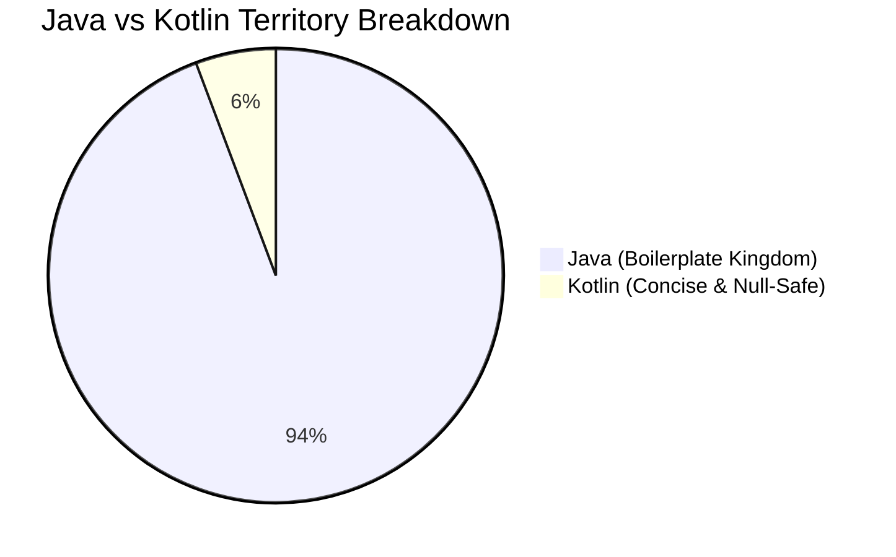

# 🚀 The Great Java-to-Kotlin Migration Chronicles ☕➡️🟣

> *"There are two types of developers: those who migrate to Kotlin, and those who spend their weekends debugging `NullPointerException`."* — *Ancient Android Proverb*

---

## 📊 1. The High-Level Battle Ground

We ran the scouters over the codebase, and here is the pulse check of our crusade against semicolon tyranny:

```
Total Files Analyzed : 525
Java Holdouts (☕)    : 495 files (94.3%)
Kotlin Chads  (🟣)   :  30 files  (5.7%)
```

### 🥧 The Codebase Pie Chart



---

---

## 🗺️ 2. Domain-by-Domain Progress: *The Conquest of CashLedger*


### ⚔️ Realm Status Log & Boss Encounters

#### 🏰 Realm I: The Citadel of Activities (UI Frontline)
* **Liberation Progress**: `[██████████░░░░░░░░░░]` **47.7%**
* **Status**: ⚔️ **HEATED SIEGE**
* **Garrison**: `21` Kotlin Knights vs `23` Java Defenders
* **Current Boss Fight**: `MainActivity.java` *(HP: 950 Lines | Special Attack: Intent Spam)*
* **Loot Upon Victory**: `+50 Null Safety`, `-420 Semicolons`

#### 🧩 Realm II: The Fragment Outposts (Component Layer)
* **Liberation Progress**: `[██░░░░░░░░░░░░░░░░░░]` **10.0%**
* **Status**: 🏹 **SCOUTING PARTY ADVANCING**
* **Garrison**: `3` Kotlin Scouts ([TransactionListScreen](https://github.com/solomonrajan/cashledger/blob/javatokotlin/app/src/main/java/com/oriondev/moneywallet/ui/fragment/multipanel/TransactionListScreen.kt), [TransactionMultiPanelFragment](https://github.com/solomonrajan/cashledger/blob/javatokotlin/app/src/main/java/com/oriondev/moneywallet/ui/fragment/multipanel/TransactionMultiPanelFragment.kt), [AboutFragment](https://github.com/solomonrajan/cashledger/blob/javatokotlin/app/src/main/java/com/oriondev/moneywallet/ui/fragment/single/AboutFragment.kt))
* **Objective**: Infiltrate primary balance & summary tabs without triggering `IllegalStateException: Fragment not attached`

#### 💀 Realm III: The Catacombs of Data & DAOs (Storage Depths)
* **Liberation Progress**: `[░░░░░░░░░░░░░░░░░░░░]` **0.0%**
* **Status**: 🔒 **ANCIENT JAVA CITADEL**
* **Threat Level**: 🌋 *Extreme*
* **Dungeon Bosses**: `WalletDAO.java`, `TransactionDatabase.java`, `MWBackupImporter.java`
* **Debuff**: Every query incurs +5 verbose cursors and manual index mappings

#### 🧪 Realm IV: The Proving Grounds (Test Suite)
* **Liberation Progress**: `[░░░░░░░░░░░░░░░░░░░░]` **0.0%**
* **Status**: ⏳ **PEACEFUL STALEMATE**
* **Roster**: `63` Unit Tests + `8` Android Instrumented Tests
* **Strategy**: Deploy modern Kotlin DSL assertions & coroutine test scopes once the battle moves deeper

---

## 🔥 3. Kotlin Migration Heat Map

Visual progress status across different modules:

| Module / Package | Kotlin | Java | Progress | Risk Level | Status Heatmap |
| :--- | :---: | :---: | :---: | :---: | :--- |
| **`ui/activity`** | 21 | 23 | **47.7%** | 🟡 Medium | `🟩🟩🟩🟩🟩🟨🟨🟨🟨🟨` *Civil War in Progress* |
| **`ui/fragment`** | 3 | 27 | **10.0%** | 🟠 High | `🟩🟨🟥🟥🟥🟥🟥🟥🟥🟥` *Reconnaissance Mission* |
| **`updater`** | 2 | 0 | **100.0%** | 🟢 Safe | `🟩🟩🟩🟩🟩🟩🟩🟩🟩🟩` *Liberated Territory* 🏆 |
| **`model`** | 1 | 38 | **2.6%** | 🔴 Extreme | `🟨🟥🟥🟥🟥🟥🟥🟥🟥🟥` *Getters & Setters Everywhere* |
| **`storage/database`**| 0 | 54 | **0.0%** | 💀 Critical | `🟥🟥🟥🟥🟥🟥🟥🟥🟥🟥` *The Semicolon Citadel* |
| **`utils`** | 0 | 36 | **0.0%** | 🔴 High | `🟥🟥🟥🟥🟥🟥🟥🟥🟥🟥` *Static Class Graveyard* |
| **`service & background`**| 0 | 18 | **0.0%** | 🟠 High | `🟥🟥🟥🟥🟥🟥🟥🟥🟥🟥` *Background Boilerplate* |
| **`tests (src/test)`** | 0 | 63 | **0.0%** | 🟡 Medium | `🟥🟥🟥🟥🟥🟥🟥🟥🟥🟥` *Legacy Assertions* |

---

## 🏆 4. Hall of Fame (Converted Kotlin Files)

These brave `30` files threw away the Java syntax baggage:

### 👑 Activities
* [AboutActivity.kt](https://github.com/solomonrajan/cashledger/blob/javatokotlin/app/src/main/java/com/oriondev/moneywallet/ui/activity/AboutActivity.kt)
* [BackendExplorerActivity.kt](https://github.com/solomonrajan/cashledger/blob/javatokotlin/app/src/main/java/com/oriondev/moneywallet/ui/activity/BackendExplorerActivity.kt)
* [BackupListActivity.kt](https://github.com/solomonrajan/cashledger/blob/javatokotlin/app/src/main/java/com/oriondev/moneywallet/ui/activity/BackupListActivity.kt)
* [CalculatorActivity.kt](https://github.com/solomonrajan/cashledger/blob/javatokotlin/app/src/main/java/com/oriondev/moneywallet/ui/activity/CalculatorActivity.kt)
* [CalendarActivity.kt](https://github.com/solomonrajan/cashledger/blob/javatokotlin/app/src/main/java/com/oriondev/moneywallet/ui/activity/CalendarActivity.kt)
* [CategoryPickerActivity.kt](https://github.com/solomonrajan/cashledger/blob/javatokotlin/app/src/main/java/com/oriondev/moneywallet/ui/activity/CategoryPickerActivity.kt)
* [CategoryRuleSortActivity.kt](https://github.com/solomonrajan/cashledger/blob/javatokotlin/app/src/main/java/com/oriondev/moneywallet/ui/activity/CategoryRuleSortActivity.kt)
* [CategorySortActivity.kt](https://github.com/solomonrajan/cashledger/blob/javatokotlin/app/src/main/java/com/oriondev/moneywallet/ui/activity/CategorySortActivity.kt)
* [ImportExportActivity.kt](https://github.com/solomonrajan/cashledger/blob/javatokotlin/app/src/main/java/com/oriondev/moneywallet/ui/activity/ImportExportActivity.kt)
* [LockActivity.kt](https://github.com/solomonrajan/cashledger/blob/javatokotlin/app/src/main/java/com/oriondev/moneywallet/ui/activity/LockActivity.kt)
* [MapActivity.kt](https://github.com/solomonrajan/cashledger/blob/javatokotlin/app/src/main/java/com/oriondev/moneywallet/ui/activity/MapActivity.kt)
* [NewEditCategoryActivity.kt](https://github.com/solomonrajan/cashledger/blob/javatokotlin/app/src/main/java/com/oriondev/moneywallet/ui/activity/NewEditCategoryActivity.kt)
* [NewEditTransactionActivity.kt](https://github.com/solomonrajan/cashledger/blob/javatokotlin/app/src/main/java/com/oriondev/moneywallet/ui/activity/NewEditTransactionActivity.kt)
* [NewEditWalletActivity.kt](https://github.com/solomonrajan/cashledger/blob/javatokotlin/app/src/main/java/com/oriondev/moneywallet/ui/activity/NewEditWalletActivity.kt)
* [PeriodDetailActivity.kt](https://github.com/solomonrajan/cashledger/blob/javatokotlin/app/src/main/java/com/oriondev/moneywallet/ui/activity/PeriodDetailActivity.kt)
* [SearchActivity.kt](https://github.com/solomonrajan/cashledger/blob/javatokotlin/app/src/main/java/com/oriondev/moneywallet/ui/activity/SearchActivity.kt)
* [TransactionListActivity.kt](https://github.com/solomonrajan/cashledger/blob/javatokotlin/app/src/main/java/com/oriondev/moneywallet/ui/activity/TransactionListActivity.kt)
* [WalletListActivity.kt](https://github.com/solomonrajan/cashledger/blob/javatokotlin/app/src/main/java/com/oriondev/moneywallet/ui/activity/WalletListActivity.kt)
* [WalletSortActivity.kt](https://github.com/solomonrajan/cashledger/blob/javatokotlin/app/src/main/java/com/oriondev/moneywallet/ui/activity/WalletSortActivity.kt)
* [WalletWidgetConfigureActivity.kt](https://github.com/solomonrajan/cashledger/blob/javatokotlin/app/src/main/java/com/oriondev/moneywallet/ui/widget/WalletWidgetConfigureActivity.kt)
* [UpdaterActivity.kt](https://github.com/solomonrajan/cashledger/blob/javatokotlin/app/src/main/java/com/oriondev/moneywallet/updater/UpdaterActivity.kt)

### 🎨 Screens, ViewModels & Helpers
* [NewEditTransactionExt.kt](https://github.com/solomonrajan/cashledger/blob/javatokotlin/app/src/main/java/com/oriondev/moneywallet/ui/activity/NewEditTransactionExt.kt)
* [NewEditTransactionScreen.kt](https://github.com/solomonrajan/cashledger/blob/javatokotlin/app/src/main/java/com/oriondev/moneywallet/ui/activity/NewEditTransactionScreen.kt)
* [TransactionListScreen.kt](https://github.com/solomonrajan/cashledger/blob/javatokotlin/app/src/main/java/com/oriondev/moneywallet/ui/fragment/multipanel/TransactionListScreen.kt)
* [TransactionListViewModel.kt](https://github.com/solomonrajan/cashledger/blob/javatokotlin/app/src/main/java/com/oriondev/moneywallet/ui/fragment/multipanel/TransactionListViewModel.kt)
* [TransactionMultiPanelFragment.kt](https://github.com/solomonrajan/cashledger/blob/javatokotlin/app/src/main/java/com/oriondev/moneywallet/ui/fragment/multipanel/TransactionMultiPanelFragment.kt)
* [AboutFragment.kt](https://github.com/solomonrajan/cashledger/blob/javatokotlin/app/src/main/java/com/oriondev/moneywallet/ui/fragment/single/AboutFragment.kt)
* [WalletWidgetConfigureViewModel.kt](https://github.com/solomonrajan/cashledger/blob/javatokotlin/app/src/main/java/com/oriondev/moneywallet/ui/widget/WalletWidgetConfigureViewModel.kt)
* [UpdaterViewModel.kt](https://github.com/solomonrajan/cashledger/blob/javatokotlin/app/src/main/java/com/oriondev/moneywallet/updater/UpdaterViewModel.kt)
* [GithubRelease.kt](https://github.com/solomonrajan/cashledger/blob/javatokotlin/app/src/main/java/com/oriondev/moneywallet/model/GithubRelease.kt)

---

## 🎯 5. Top Bounty Targets (Most Wanted Java Files)

```
================================================================================
 WANTED FOR UNLAWFUL VERBOSITY & WANTON ALLOCATION OF GETTERS/SETTERS
================================================================================
 [1] MainActivity.java                    - The Grand Entrance 🏰
 [2] LauncherActivity.java                - The Launchpad 🚀
 [3] NewEditTransferActivity.java         - Money Moving Monster 💸
 [4] NewEditBudgetActivity.java           - Budget Boss 🧮
 [5] NewEditSavingActivity.java           - Piggy Bank Enforcer 🐷
 [6] CurrencyListActivity.java            - Forex Fortress 💱
================================================================================
 REWARD: Infinite peace of mind & 0.00 NullPointerExceptions!
================================================================================
```

---

## 🎭 6. Funny Codes: Java PTSD vs Kotlin Zen

### Case 1: Checking a nested wallet balance

#### ☕ Java's Rite of Passage (Defensive Programming Hell)
```java
// Java: "Please, Mr. Compiler, don't crash the entire app today"
public String getBalanceFormatted(User user) {
    if (user != null) {
        Wallet wallet = user.getDefaultWallet();
        if (wallet != null) {
            Balance balance = wallet.getBalance();
            if (balance != null) {
                Currency currency = balance.getCurrency();
                if (currency != null) {
                    return currency.getSymbol() + " " + balance.getAmount();
                }
            }
        }
    }
    return "$ 0.00"; // 6 nested ifs just to buy a coffee
}
```

#### 🟣 Kotlin's Chad One-Liner
```kotlin
// Kotlin: "Look at what they need to mimic a fraction of our power."
fun getBalanceFormatted(user: User?): String = 
    "${user?.defaultWallet?.balance?.currency?.symbol ?: "$"} ${user?.defaultWallet?.balance?.amount ?: "0.00"}"
```

---

### Case 2: Model POJO Declaration

#### ☕ Java: 120 lines of ceremonial boilerplate
```java
public class TransactionTag {
    private long id;
    private String name;
    private int colorHex;

    public TransactionTag(long id, String name, int colorHex) {
        this.id = id;
        this.name = name;
        this.colorHex = colorHex;
    }

    public long getId() { return id; }
    public void setId(long id) { this.id = id; }

    public String getName() { return name; }
    public void setName(String name) { this.name = name; }

    public int getColorHex() { return colorHex; }
    public void setColorHex(int colorHex) { this.colorHex = colorHex; }

    @Override
    public boolean equals(Object o) { /* another 20 lines generated by IDE */ }
    @Override
    public int hashCode() { /* another 10 lines */ }
    @Override
    public String toString() { /* another 15 lines */ }
}
```

#### 🟣 Kotlin: Blink and you miss it
```kotlin
data class TransactionTag(val id: Long, val name: String, val colorHex: Int)
```

---

### Case 3: Casting & Instance Checks

#### ☕ Java (Pre-16)
```java
if (event instanceof TransactionEvent) {
    TransactionEvent transactionEvent = (TransactionEvent) event;
    transactionEvent.triggerSoundEffects();
}
```

#### 🟣 Kotlin Smart Casts
```kotlin
if (event is TransactionEvent) event.triggerSoundEffects() // The compiler isn't blind!
```

---

## 🔮 7. Strategic Battle Plan


> **Pro-tip:** Every converted Java file eliminates an average of 42 semicolons and reduces line count by 35%. Long live `val` and `?.`! 🚀

---

## 📜 8. Chronicles of the Crusade (Recent Commits & Dispatches)

> *A live dispatch of recent engineering battles, architecture refactors, and UI modernization on this branch:*

<details open>
<summary><b><code>df76660</code></b> — <b>UI: Implement dynamic wallet names and adaptive sizing in Segmented Buttons</b> <i>(2026-10-07 by Solomon Rajan)</i></summary>

* **Commit Link**: [`df76660`](https://github.com/solomonrajan/cashledger/commit/df76660)
* **Author**: Solomon Rajan • **Date**: 2026-10-07
* **Description / Scope**:
  > - **Realistic Data Rendering:** Replaced generic "Wallet 1" placeholders with concrete user wallet examples ("tow wallet", "State Bank of India") to visualize realistic layout constraints.
  > - **Inline Selection:** Re-architected the segmented button interactions. Tapping a specific wallet button now acts as a direct inline selection instead of spawning the picker popup, reserving the popup strictly for the '+ Add' action.
  > - **M3 Adaptive Text:** Removed strict `maxLines=1` text truncations. Adhering to Material 3 Button Group guidelines (which mandate equal width for all segments), the buttons will now dynamically wrap text and increase their vertical height to prevent any overlapping or clipping when displaying long wallet names.

</details>

<details open>
<summary><b><code>801b268</code></b> — <b>Fix: Resolve dangling brace compilation error in transaction screen</b> <i>(2026-10-07 by Solomon Rajan)</i></summary>

* **Commit Link**: [`801b268`](https://github.com/solomonrajan/cashledger/commit/801b268)
* **Author**: Solomon Rajan • **Date**: 2026-10-07
* **Description / Scope**:
  > - **Syntax Hotfix:** Removed an orphaned trailing `}` at the end of `NewEditTransactionScreen.kt` that was left behind after removing the custom chip composables.
  > - **CI Build Restored:** This resolves the "Expecting a top level declaration" syntax error and restores the `compileFlossOsmDebugKotlin` Gradle build pipeline to a passing state.

</details>

<details open>
<summary><b><code>2a9bdd8</code></b> — <b>UI: Enforce strict Material 3 guidelines for button groups and chips</b> <i>(2026-10-07 by Solomon Rajan)</i></summary>

* **Commit Link**: [`2a9bdd8`](https://github.com/solomonrajan/cashledger/commit/2a9bdd8)
* **Author**: Solomon Rajan • **Date**: 2026-10-07
* **Description / Scope**:
  > - **Segmented Button Group:** Refactored the wallet selection row from loose individual chips into a native `SingleChoiceSegmentedButtonRow`. This perfectly implements the M3 Button Group specification, visually merging the wallet options and 'Add wallet' action into a single cohesive, pill-shaped selector unit.
  > - **Strict M3 InputChips:** Removed the oversized custom chip implementations and reverted the Event, People, and Place attributes to utilize native Compose M3 `InputChip` components.
  > - **Guideline Compliance:** This ensures the secondary attributes strictly adhere to official Material Design 3 Chip guidelines, automatically enforcing standard `32.dp` heights, `8.dp` corner radiuses, and standardized interactive state formatting.

</details>

<details open>
<summary><b><code>5834454</code></b> — <b>UI: Enhance transaction screen with bold M3 Expressive coloring and layering</b> <i>(2026-10-07 by Solomon Rajan)</i></summary>

* **Commit Link**: [`5834454`](https://github.com/solomonrajan/cashledger/commit/5834454)
* **Author**: Solomon Rajan • **Date**: 2026-10-07
* **Description / Scope**:
  > - **Amount Card Layering:** Re-themed the primary amount card to utilize a soft `primaryContainer` background with an expansive `28.dp` corner radius.
  > - **Nested Tactile Buttons:** Redesigned the inline calculator action to sit within its own semi-translucent `surface` squircle (`16.dp` radius), introducing a rich, layered "button-within-a-card" aesthetic that perfectly mirrors the target design mockup.
  > - **Maximized Primary Action:** Upgraded the "Save Transaction" pill button to use fully saturated `primary` colors, establishing a bold visual anchor at the bottom of the screen that commands attention and cleanly reduces perceived blank space.

</details>

<details open>
<summary><b><code>43afd2c</code></b> — <b>UI: Modernize transaction attributes with M3 Expressive InputChips</b> <i>(2026-10-07 by Solomon Rajan)</i></summary>

* **Commit Link**: [`43afd2c`](https://github.com/solomonrajan/cashledger/commit/43afd2c)
* **Author**: Solomon Rajan • **Date**: 2026-10-07
* **Description / Scope**:
  > - **FlowRow Grouping:** Replaced the bulky, vertically stacked `OutlinedTextField` implementations for Wallet, Event, People, and Place with a responsive `FlowRow`, drastically reducing visual clutter and vertical scroll fatigue on the new transaction screen.
  > - **Expressive InputChips:** Transitioned the attribute selectors to highly interactive M3 `InputChip` components.
  > - **Context-Aware States:** The chips dynamically reflect their selection state (utilizing `primaryContainer` highlighting when active) and now expose inline trailing actions, such as a dropdown chevron for wallets and a quick-clear (`✖`) action for events, people, and places, fully adhering to Google's Material 3 Expressive guidelines.

</details>

<details open>
<summary><b><code>f27d42f</code></b> — <b>Fix: Resolve detekt static analysis violations in CalculatorActivity</b> <i>(2026-10-07 by Solomon Rajan)</i></summary>

* **Commit Link**: [`f27d42f`](https://github.com/solomonrajan/cashledger/commit/f27d42f)
* **Author**: Solomon Rajan • **Date**: 2026-10-07
* **Description / Scope**:
  > - **Reduce Nesting Depth:** Refactored the `getLiveResult` calculator logic to utilize Kotlin's `.find` and early returns, flattening the control flow to resolve the `[NestedBlockDepth]` violation.
  > - **Specific Exception Handling:** Replaced the generic `Exception` catch block with explicit captures for `NumberFormatException` and `ArithmeticException`, directly satisfying the `[TooGenericExceptionCaught]` rule.
  > - **Suppress Expected Fallbacks:** Added the `@Suppress("SwallowedException")` annotation to formally acknowledge that swallowing calculation errors and returning the raw string is the intended UI fallback behavior.

</details>

<details open>
<summary><b><code>96c88be</code></b> — <b>Feature: Add live equation preview and instant calculation</b> <i>(2026-10-07 by Solomon Rajan)</i></summary>

* **Commit Link**: [`96c88be`](https://github.com/solomonrajan/cashledger/commit/96c88be)
* **Author**: Solomon Rajan • **Date**: 2026-10-07
* **Description / Scope**:
  > - **Live Calculation Engine:** Implemented a new `getLiveResult` evaluator in `CalculatorActivity` that parses and computes the current expression on the fly using `BigDecimal` for perfect precision.
  > - **Dynamic Dual-Display:** Restructured the calculator amount card to intelligently utilize vertical space. While typing an equation, the raw expression (e.g., `12 + 1`) gracefully shifts up as a smaller, faded subtitle, while the massive, dynamic main text immediately displays the live evaluated result (e.g., `13`).
  > - **Enhanced UX:** This transforms the calculator from a static input field into a highly responsive, smart UI that instantly informs the user of the pending outcome before they even hit the execute key.

</details>

<details open>
<summary><b><code>b743994</code></b> — <b>UI: Maximize Calculator expression with tall typography and perfect circular keys</b> <i>(2026-10-06 by Solomon Rajan)</i></summary>

* **Commit Link**: [`b743994`](https://github.com/solomonrajan/cashledger/commit/b743994)
* **Author**: Solomon Rajan • **Date**: 2026-10-06
* **Description / Scope**:
  > - **Maximized Vertical Display:** Significantly boosted the starting dynamic font size of the amount card to `144.sp` for 1-2 digits. This authentically mimics Google's Material 3 Expressive calculators by allowing the baseline value (`0`) to command and completely fill the vertical bounds of the display card, gracefully scaling down to `46.sp` as more digits are typed.
  > - **Authentic Circular Geometry:** Refined the keypad button layouts by enforcing a strict `1:1` aspect ratio coupled with `CircleShape`. This effortlessly transforms the squarish keys into perfect, playful geometric circles and renders the execution button as a fully rounded pill.
  > - **Prominent Key Typography:** Upgraded the font style within the keypad buttons from `headlineMedium` to `displaySmall`, ensuring the digits and operations are visually prominent and balanced within their new circular bounds.

</details>

