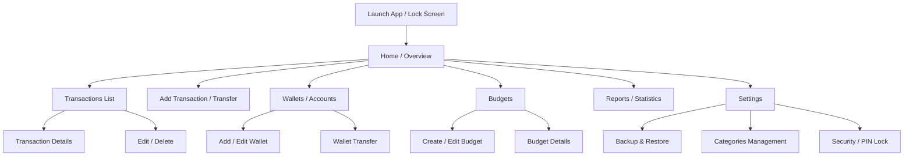

<div align="center">


# Cash Ledger

An expense and budget tracker for Android that keeps your money on your own phone.

[](https://www.gnu.org/licenses/gpl-3.0.html)
[](https://github.com/solomonrajan/cashledger/releases/latest)
[](KOTLIN_MIGRATION.mdx)
[](app/build.gradle)

[](https://github.com/solomonrajan/cashledger/releases/latest)

</div>

Cash Ledger tracks what you spend and what you have, across as many wallets as you keep. It runs with no network connection and asks for no account. [PRIVACY.md](PRIVACY.md) lists every way data leaves the app.

The GitHub Actions build is reproducible and carries the developer signature, so the APK attached to each [release](https://github.com/solomonrajan/cashledger/releases) can be installed directly and safely.

<div align="center">


</div>

## 📑 Table of Contents

| Section                                                      | Description                                        |
| ------------------------------------------------------------ | -------------------------------------------------- |
| [✨ What it does](#what-it-does)                             | Features and capabilities of Cash Ledger           |
| [🗺️ App Blueprint](#app-blueprint)                           | UI/UX Flow and Navigation Map                      |
| [📱 App Pages](#app-pages)                                   | List of screens in the application                 |
| [💻 Technology Stack](#technology-stack)                     | Languages, frameworks, and architecture used       |
| [🔄 Coming from Tallybook](#coming-from-tallybook)           | Information for users migrating from Tallybook     |
| [📚 Docs](#docs)                                             | Documentation, guides, and privacy policy          |
| [🛠️ Build from source](#build-from-source)                   | Instructions to build the app from source          |
| [🤝 Contributing](#contributing)                             | How to contribute to the project                   |
| [🙏 Credits and Acknowledgment](#credits-and-acknowledgment) | People and projects that made Cash Ledger possible |

## ✨ What it does

- **Wallets.** Keep as many as you need, each in its own currency.
- **Categories.** Group spending into categories and subcategories, and open a category total into the ones underneath it.
- **Budgets.** Set a limit for a period, cover more than one category with it, and let it repeat into the next period on its own.
- **Recurring transactions.** Post on a schedule you set, including transfers between wallets.
- **Debts and savings goals.** Track what you owe, what you are owed, and what you are putting aside.
- **Reports.** See a period's income and spending, with charts by category.
- **Calendar.** A day strip marks the days that have transactions.
- **Widget.** A home screen widget shows one wallet's balance.
- **Backup.** Write to a local folder, to your own WebDAV server such as Nextcloud or a NAS, or through Android's own backup.
- **Import and export.** CSV in, and CSV, XLS or PDF out, plus the older Tallybook backup file.
- **Lock.** An optional PIN, pattern or fingerprint when the app opens.

## 🗺️ App Blueprint

The following diagram illustrates the primary user flows and navigation structure within Cash Ledger:



## 📱 App Pages

Here is a breakdown of the various pages (Activities and Settings panels) available in the app:

### Core / Initial Pages

- **Launcher Page**: The startup or splash screen (`LauncherActivity`).
- **Main Page**: The main dashboard or entry point of the app (`MainActivity`).
- **Tutorial Page**: Intro and onboarding screens for new users (`TutorialActivity`).
- **Lock Screen**: The PIN, pattern, or biometric lock screen (`LockActivity`).

### Lists & Overviews

- **Transaction List**: Shows a list of transactions (`TransactionListActivity`).
- **Wallet List**: Displays all your accounts/wallets (`WalletListActivity`).
- **Calendar View**: Shows transactions organized on a calendar (`CalendarActivity`).
- **Map View**: A map page showing locations of transactions (`MapActivity`).
- **Period Detail**: Shows a detailed breakdown of a specific time period (`PeriodDetailActivity`).
- **Currency List**: A list of available currencies (`CurrencyListActivity`).

### Creation / Editing Pages

- **New/Edit Transaction** (`NewEditTransactionActivity`)
- **New/Edit Transfer** (`NewEditTransferActivity`)
- **New/Edit Wallet** (`NewEditWalletActivity`)
- **New/Edit Category** (`NewEditCategoryActivity`)
- **New/Edit Budget** (`NewEditBudgetActivity`)
- **New/Edit Debt** (`NewEditDebtActivity`)
- **New/Edit Saving** (`NewEditSavingActivity`)
- **New/Edit Event** (`NewEditEventActivity`)
- **New/Edit Place** (`NewEditPlaceActivity`)
- **New/Edit Person** (`NewEditPersonActivity`)
- **New/Edit Currency** (`NewEditCurrencyActivity`)
- **New/Edit Item** (`NewEditItemActivity`)
- **New/Edit Recurrent Transaction / Transfer** (`NewEditRecurrentTransactionActivity`, `NewEditRecurrentTransferActivity`)
- **New/Edit Transaction / Transfer Model** (`NewEditTransactionModelActivity`, `NewEditTransferModelActivity`)

### Sorting & Configuration Pages

- **Settings**: Multi-panel configuration across Database, UI, and Utilities (`SettingMultiPanelFragment`, `DatabaseSettingFragment`, `UserInterfaceSettingFragment`, `UtilitySettingFragment`).
- **Category Picker / Sort**: `CategoryPickerActivity`, `CategorySortActivity`.
- **Category Rules**: `CategoryRuleListActivity`, `NewEditCategoryRuleActivity`, `CategoryRuleSortActivity`.
- **Wallet Sort**: `WalletSortActivity`.
- **Icon List**: Pick icons for categories or wallets (`IconListActivity`).
- **Place Picker**: Select a location on a map (`PlacePickerActivity`, `osm` flavor).

### Tools, Widgets & System Pages

- **Search Page**: Find specific transactions (`SearchActivity`).
- **Calculator**: Built-in arithmetic calculator utility (`CalculatorActivity`).
- **Home Screen Widget**: Configure per-wallet balance widgets (`WalletWidgetConfigureActivity`).
- **Import / Export**: Export or import ledger data (`ImportExportActivity`).
- **Backup List**: View and manage existing backups (`BackupListActivity`).
- **Backend Explorer**: Browse backup folders and remote/local storage backends (`BackendExplorerActivity`).
- **About Page**: Shows app info, versions, and credits (`AboutActivity`).

## 💻 Technology Stack

Cash Ledger is built as a fully native, offline-first, and privacy-respecting Android application (`minSdk 24` / Android 7.0 through `targetSdk 35` / Android 15, `compileSdk 36`).

**Languages & Kotlin Migration**

- **Language:** Kotlin (`1.9.22`) & Java 17 — currently **60.3% pure Kotlin** across the tracked codebase (`312 / 517` files; **70.0%** or `312 / 446` in `app/src/main`, with Phases 1–5 complete). Follow live progress in [KOTLIN_MIGRATION.mdx](KOTLIN_MIGRATION.mdx).
<div align="center">
  
</div>

**Frontend & UI**

- **Framework:** Native Android SDK (AndroidX, XML Layouts / Views)
- **Design System:** Material Design Components & Material Symbols
- **Data Visualization & UX:** `MPAndroidChart`, `Glide`, `AppIntro`, `OSMdroid` (`osm` flavor maps), `PatternLockView`, `PinLockView`

**Backend, Storage & Quality**

- **Database:** Local SQLite & `ContentProvider` (offline-first architecture, zero accounts or telemetry)
- **Backups:** Storage Access Framework (`DocumentFile`), WebDAV via `OkHttp` (Nextcloud / NAS), AES-encrypted `Zip4j` archives, and Android Auto Backup
- **Import / Export & Recurrence:** CSV (`OpenCSV`), XLS (`JExcelApi`), PDF (`iTextPDF`), RFC recurrence (`lib-recur`), and legacy MoneyWallet / Tallybook backups
- **Static Analysis & Testing:** Detekt (`1.23.6`, zero-`!!` policy), Android Lint (`abortOnError`), JUnit 4, Robolectric, and Mockito

## 🔄 Coming from Tallybook

As Cash Ledger is a separate app with its own application id, it installs beside the original Tallybook or MoneyWallet and does not replace them or carry its data across on its own. Please refer to [MIGRATION.md](MIGRATION.md) for information on migrating your data.

## 📚 Docs

- [Kotlin Migration Roadmap & Tracker](KOTLIN_MIGRATION.mdx)
- [Kotlin Migration Guidelines](docs/KOTLIN_GUIDELINES.md)
- [FAQ](docs/FAQ.md)
- [Moving from Tallybook](MIGRATION.md)
- [CSV import format](docs/CSV.md)
- [Privacy](PRIVACY.md)
- [Third party notices](THIRD_PARTY_NOTICES.md)

Every release note is on the [releases page](https://github.com/solomonrajan/cashledger/releases).

## 🛠️ Build from source

Build the `floss` + `osm` flavors, which use OpenStreetMap and no proprietary services:

```bash
./gradlew assembleFlossOsmDebug
```

Run unit tests, Android Lint, and Detekt static analysis locally (matching CI):

```bash
./gradlew testFlossOsmDebugUnitTest lintFlossOsmDebug detekt
```

Requirements: a recent Android SDK (`compileSdk 36`) and JDK 17 or newer. Release builds use JDK 21, which is what the GitHub Actions build server uses, so a release built on an older JDK will not reproduce.

## 🤝 Contributing

Bug reports and pull requests are welcome in the [issue tracker](https://github.com/solomonrajan/cashledger/issues). Current direction and open work live in the pinned [roadmap issue](https://github.com/solomonrajan/cashledger/issues/15).

[CONTRIBUTING.md](CONTRIBUTING.md) has the bar a pull request is held to, including an AI written one, and the steps for translating.

## 🙏 Credits and Acknowledgment

Cash Ledger is free software under the GNU General Public License v3.0 or later, the same license as the project it came from. See [LICENSE.md](LICENSE.md).

### The History of Cash Ledger

The original code that laid the foundation for this project was **MoneyWallet** ([repository](https://github.com/AndreAle94/moneywallet)), created by [AndreAle94](https://github.com/AndreAle94) and contributors. MoneyWallet was an excellent open-source expense tracker but has not seen a release since 2021.

To keep the project alive, [herrerad85](https://github.com/herrerad85) created **Tallybook** ([repository](https://github.com/herrerad85/tallybook)), a maintained fork of MoneyWallet. Tallybook carried the torch forward, ensuring the app continued to work.

**Cash Ledger** is a fork of Tallybook. I forked this project to continue its legacy, deeply modernizing the UI/UX, refining the design aesthetics, and ensuring the app remains usable and up-to-date with modern Android standards. The goal is to provide a premium, dynamic, and beautiful interface while keeping the powerful offline-first core functionality that users loved in the original apps.

We owe a huge thanks to [AndreAle94](https://github.com/AndreAle94) and [herrerad85](https://github.com/herrerad85) for their hard work. Cash Ledger is independent and is not endorsed by or affiliated with the original authors.

<div align="justify">

The intro illustrations and the new app icon are designed by [solomonrajan](https://github.com/solomonrajan) (commit ID [3b9cac8](https://github.com/solomonrajan/cashledger/commit/3b9cac8)), released under the GPLv3. The category picker icons and UI elements use glyphs from Material Symbols. Full license texts are in [THIRD_PARTY_NOTICES.md](THIRD_PARTY_NOTICES.md).

</div>
